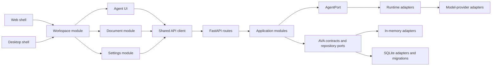

# AVA architecture report — code-only review

## Scope and method

This report was produced from application source, tests, build manifests, and runtime configuration only. It did not use repository Markdown documents, plans, ADRs, prior audit reports, or commit messages as architectural input.

The code forms a modular monolith: a Python/FastAPI backend, TypeScript shared packages for the user interface, thin Web and Tauri Desktop entry points, and a separate Python client. The training directory is isolated from the runtime application: no runtime application module imports it.

## System shape



The diagram describes the main production path. The composition root constructs concrete adapters, stores them on the FastAPI application state, and routes obtain the narrow application module needed for each request.

## Backend

### Transport and composition

`backend/src/ava/api/app.py` is the backend composition root. It constructs configuration, registries, persistence, execution selection, application modules, and route registration. Routes are deliberately thin: for example, `routes/runs.py` obtains `RunService` from `request.app.state`, and the service owns run behavior.

This produces a clear external seam: HTTP routes do not create persistence or execution adapters. It also makes `app.state` a service locator. The locator is practical at the current size, but it hides a route's required interface from its function signature and makes the composition root the highest-coupling module in the backend. The root currently owns construction of more than twenty runtime values. A next refactor should group these into a typed application container or a small number of composition aggregates without moving domain behavior into the container.

### Core, contracts, and application modules

The stable backend interfaces are concentrated in:

- `contracts/`: wire and cross-module data models.
- `repositories/`: persistence interfaces and records.
- `agents/contracts.py`: the `AgentPort` seam.
- `runtimes/contracts.py`: the `AgentRuntimePort` seam.
- `models/contracts.py`: the model-provider seam.

The strongest deep modules are `RunLifecycleService`, `RunService`, `ContextConstructionService`, `ConversationService`, and `DocumentService`. Callers hand these modules durable identifiers and AVA-owned data; the modules hide state validation, event generation, context building, and persistence coordination. `RunLifecycleService` is especially well-shaped: it owns the transition table and guarded write behavior instead of distributing transition rules across callers.

`core/Application` is intentionally small and currently contributes only immutable configuration/name access. It is a shallow module rather than the center of application behavior; the actual application logic lives in `services/`. That is not presently harmful, but a future expansion should either give this module a real coordination interface or avoid treating it as the domain root in new code.

### Execution path

The run path is arranged as a set of explicit seams:

```text
RunService
  -> AgentPort
  -> NativeAgentAdapter
  -> ExecutionSelector
  -> AgentRuntimePort + ModelProviderPort + workspace binding
```

This is a sound separation. `RunService` does not select a runtime or model provider; it receives the `AgentPort` interface. Runtime adapters normalize provider/framework results back to AVA result types. The OpenHands adapter contains its command, filesystem, and tool controls instead of exposing them to the rest of the application.

The configuration resolver and provider factory are separate from the run module. That keeps persisted settings resolution and credential lookup out of ordinary run lifecycle code. It also means a new provider should be added by implementing an adapter and registering it in composition, rather than by changing routes or run orchestration.

### Persistence

Repository interfaces have two real adapter families: in-memory stores under `services/` and relational SQLite adapters under `infrastructure/persistence/repositories/`. This is a real seam, not a hypothetical abstraction: both families implement the same repository interfaces.

`SqliteDatabase` owns migration, transaction, and connection lifecycle. It serializes access to one shared SQLite connection with a re-entrant lock, and repository writes use explicit transactions. This gives strong in-process correctness and concentrates SQLite-specific behavior in one module. The tradeoff is explicit: one process serializes all database work through one connection. That is a reasonable local-development architecture, but it is a throughput and multi-process limit for any future deployment with concurrent workers.

The run repository and lifecycle module reinforce each other: database-level compare-and-set protects state updates, while lifecycle code decides whether a state transition is legal. This is a good split of responsibility.

## Frontend

### Package graph

The frontend is a directed package graph:

```text
contracts
  <- api-client
  <- agent-ui, document-core, settings-core
  <- workspace
  <- web shell, desktop shell

ui-core
  <- agent-ui, document-core, settings-core, workspace
```

The Web and Desktop applications are thin entry modules. Both construct an `ApiClient` and render `AppWorkspace`; desktop-native Rust code remains a shell around the same frontend distribution. This is a good shared-product seam: feature behavior belongs in packages, not platform entry points.

### State and interaction

`AppWorkspace` is the frontend composition module. It nests `ConversationProvider`, `DocumentProvider`, and `AgentRunProvider`, then composes chat, document, and settings views. Each provider owns a distinct state concern:

- `ConversationProvider` hydrates and reconciles durable conversations/messages.
- `AgentRunProvider` owns run submission, cancellation, streaming observation, recovery, and supersession protection.
- `DocumentProvider` owns document state and persistence operations.
- `SettingsWorkspace` owns settings resource loading and editor state.

Run orchestration is intentionally React-free in `conversationRun.ts`; the provider injects state commands and an API-agent interface. This is a deep module with good leverage: retry, regeneration, stream replay, cancellation, and stale-result protection can be tested without rendering a UI.

`AppWorkspace` itself is becoming a shallow composition module. It owns workspace visibility, connection health, discovery inventories, selection, execution controls, and provider wiring in one React file. The implementation is understandable today, but it is the most likely frontend module to accumulate unrelated change. The natural next seam is a dedicated execution-selection state module and a workspace-navigation module, leaving `AppWorkspace` to compose their interfaces.

### Client boundary

`ApiClient` centralizes JSON, multipart, streaming, timeout, and error behavior. That is a strong frontend-to-backend seam. Its module-level connectivity listener set is a design tradeoff: every `ApiClient` instance reports into one global subscription set. With the current one-client-per-shell model this is simple; with multiple backend connections or embedded workspaces, reachability from one client could update listeners associated with another. Make connectivity an instance-owned interface before supporting multiple simultaneous base URLs.

## Cross-cutting observations

1. The application has clear adapter seams where variation exists: repositories, model providers, runtimes, agent adapters, attachment stores, and frontend platform shells.
2. It keeps framework-specific behavior mostly at the edges. FastAPI is contained in `api/`; SQLite is contained in persistence infrastructure; Tauri is isolated in the desktop shell; model/runtime SDKs are contained in adapters.
3. Contracts are duplicated across Python and TypeScript packages rather than generated from one source. This is a legitimate ownership choice, but it makes contract-drift tests important because the HTTP interface has two type systems.
4. The code uses durable identifiers and repository-mediated state transitions for conversations and runs, while the frontend maintains a local observer epoch. This is the right distinction: durable application state and per-browser observation ownership are different concerns.
5. The codebase has two composition hot spots: backend `create_app()` and frontend `AppWorkspace`. Both are reasonable current roots; both should resist acquiring business rules.

## Recommended architectural direction

Keep the current modular-monolith shape. The most valuable next changes are structural, not a framework rewrite:

1. Introduce a typed backend composition aggregate so routes can receive explicit dependencies without widening service interfaces.
2. Split `AppWorkspace` by responsibility before new workspace modes add more state.
3. Make connectivity status instance-owned in `ApiClient` if multi-endpoint support is planned.
4. Treat the shared SQLite connection as a deliberate single-process adapter. Add a second persistence adapter only when deployment concurrency creates a real need.
5. Preserve the existing run/execution seams: new tool, provider, or runtime work should enter through the existing AVA-owned interfaces rather than through route handlers or UI modules.

## Confidence and limits

This is a static code architecture assessment. It describes ownership, imports, seams, and composition visible in source. It does not claim live operational behavior, performance characteristics under load, or production deployment topology.
