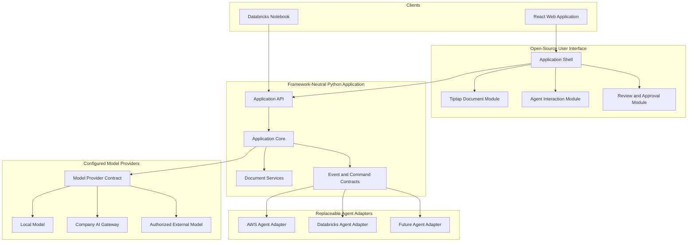

# Architecture

## Purpose

The system is a reusable AI document workspace. Users can work with documents through a browser, while Databricks notebooks can invoke the same Python application programmatically.

The Python application coordinates documents, conversations, tools, approvals, and agent execution. Agent frameworks are attached through adapters and can be replaced without redesigning the user interface.

## Logical architecture

## Architectural boundaries

### User-interface boundary

The React application owns presentation and browser interaction. It must not contain agent-framework orchestration or provider-specific credentials.

Tiptap and the selected agent UI are wrapped behind application-owned interfaces so either dependency can be replaced later.

### Application boundary

The Python application is the stable entry point for both browser and notebook clients. It owns request validation, run management, document operations, approvals, tool coordination, and agent-adapter selection.

### Agent boundary

Each agent integration implements the same application-defined contract. AWS-specific, Databricks-specific, or framework-specific objects stay inside their corresponding adapters.

### Model-provider boundary

The agent uses the model provider selected in application configuration. Local, company-hosted, and authorized external providers implement the same model-provider contract. Changing providers must not require rewriting the agent workflow, document interface, notebook client, or shared application core.

Local execution is a required development path so work can begin before company AI gateway access is available. It is an additional deployment option rather than a permanent replacement for the approved company gateway.

### Notebook boundary

A Databricks notebook acts as an API client. It submits a task, references or supplies document content, monitors execution, and retrieves structured results. The notebook does not need to understand the frontend or its UI libraries.

### Plugin boundary

Cordis is planned as the plugin-management layer after the initial modules and contracts stabilize. The initial design must allow UI modules, renderers, tools, and application-specific capabilities to become plugins without being rewritten.

## Deployment flexibility

The same platform should support these deployment combinations:

- React frontend and Python API deployed together.
- React frontend deployed separately from the Python API.
- Python API deployed as a Databricks App.
- Python API deployed in an approved AWS environment.
- Databricks notebook calling an externally hosted Python API.
- Personal application using a different agent and model provider.
- Local development using a model hosted on the same machine as the application.

## Non-goals for the first release

- Building an unrestricted third-party plugin marketplace.
- Supporting every rich-document format.
- Allowing agents to execute unvalidated editor commands.
- Embedding AWS or Databricks dependencies into shared UI packages.
- Permanently binding an agent workflow to one model runtime or provider.
- Reproducing every paid Tiptap AI Toolkit feature.
