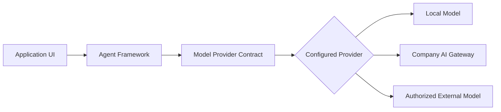

# Local Model Support Strategy

## Purpose

Access to the company AI gateway may take significant time to obtain. The application must therefore support locally hosted language models so development can begin immediately without depending on gateway availability.

The local model is not intended to permanently replace company-hosted or external models. It provides an additional model option for development, testing, demonstrations, offline operation, and potential fallback scenarios.

## Model hosting options

The application shall support three model-hosting configurations.

### 1. Local model

- Runs on the same machine as the application.
- Does not require access to the company AI gateway.
- Can operate without sending prompts or documents to an external model provider.
- Supports early development, testing, demonstrations, and offline use.

### 2. Company-hosted model

- Is accessed through the approved company AI gateway.
- Is intended to become the primary corporate production option when gateway access is available.
- Uses company-approved models, authentication, security controls, and monitoring.

### 3. External model

- Connects to an authorized external provider when permitted.
- May include Azure OpenAI, OpenAI, Anthropic, Google, or another approved service.
- Is available only when allowed by company policy and application configuration.

## Architecture principle

The agent uses whichever model provider is selected in application configuration.

The agent framework must not be permanently tied to a particular model, runtime, or provider. Changing from a local model to the company gateway must require a configuration change rather than a rewrite of the agent workflow.

## Design requirements

- All providers implement one application-owned model-provider contract.
- Provider SDKs remain inside provider adapters.
- The selected provider is controlled through configuration.
- Agents discover provider capabilities rather than assuming them.
- Unsupported model features are reported clearly.
- Local-only mode prevents external model transmission.
- Authentication credentials never enter shared UI, document, or notebook payloads.
- Provider changes do not alter the document editor, agent interface, notebook client, or workflow definitions.
- The mock provider remains available for deterministic tests that should not invoke a model.

## Development priority

The local model adapter belongs in the foundation phase. It removes company gateway access from the critical path and allows the UI, Python application, notebook client, document operations, and agent workflow to be developed and demonstrated immediately.

The company gateway adapter can be added later using the same model-provider contract.

## Production position

For corporate production, the approved company AI gateway is expected to be the primary provider when available. Local and external providers remain configurable options only where deployment policy permits them.
