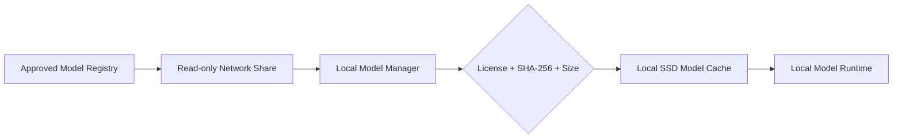

# LLM Hub Model Distribution Evaluation

## Purpose

Evaluate the text-generation models currently listed by LLM Hub for use in a company-managed local-model catalog. The intended distribution pattern is a centrally managed copy on a network drive, copied to an approved local machine, verified, and then run locally.

Catalog reviewed: LLM Hub Android `ModelData.kt`, repository revision `6503f70f52641145788ab1f2b8a094d5af94b7f1`, reviewed 2026-09-06.

## Conclusion

The design is technically feasible. GGUF and the other model packages used by LLM Hub are ordinary downloadable files and can be held on a network share. The application should copy an approved package to a local model cache before inference. It should not depend on executing or memory-mapping model weights directly from the network drive.

For the project's strict open-source requirement, begin with Apache-2.0 or MIT models. The strongest initial candidates in the current catalog are Granite 4.2 3B, Ministral 3 3B, Phi-4 Mini, and—where its specialized runtime is acceptable—Ternary Bonsai 1.7B. Gemma, Llama, and LiquidAI LFM require separate policy/legal review because their weight licenses are not standard OSI-style open-source licenses.

## Current Text-Model Families

Quantization variants are grouped under their base family rather than counted as separate models.

| LLM Hub family | Catalog variants | Weight license shown by source | Network-share distribution | Local-machine use | Project fit |
| --- | --- | --- | --- | --- | --- |
| IBM Granite | 4.0 H-Tiny, 4.0 H-Small, 4.1 3B, 4.2 3B/8B/30B | Apache-2.0 | Yes, with license and notice files | Strong GGUF support | **Preferred**; start with Granite 4.2 3B Q4_K_M |
| Mistral Ministral 3 | 3B, 8B, 14B Instruct | Apache-2.0 | Yes, with attribution and license | Strong GGUF support; 3B is the practical laptop starting point | **Preferred** |
| Microsoft Phi | Phi-4 Mini | MIT | Yes, retain MIT notice | Yes, but LLM Hub's listed package is LiteRT/`.task`; provide a separate desktop-compatible package if needed | **Preferred**, subject to runtime validation |
| OpenAI GPT-OSS | 20B | Apache-2.0 | Yes, with license and notice files | Yes in GGUF; needs materially more RAM/storage than 1B–8B options | Approved-license advanced option |
| Prism ML Ternary Bonsai | 1.7B, 4B, 8B | Apache-2.0 | Yes | Yes, but some quantizations require Prism ML's llama.cpp fork rather than stock llama.cpp | Pilot only until runtime is standardized |
| Muse Glimmer | 30B | Apache-2.0 | Yes | Yes in GGUF, but large and new; multimodal/runtime behavior needs validation | Later-stage pilot |
| Google Gemma | Gemma 3 1B/4B/12B, Gemma 3n E2B/E4B, Gemma 4 variants | Gemma Terms; some repositories are gated | Technically yes, but redistribution and acceptance workflow require legal approval | Yes in GGUF/LiteRT, depending on variant | **Do not place in the open-source-only default catalog** |
| Meta Llama | Llama 3.2 1B/3B | Llama 3.2 Community License | Technically yes, subject to the license and acceptable-use terms | Strong GGUF support | **Do not classify as open source for this project** |
| LiquidAI LFM | LFM2/2.5 1.2B through 24B, including vision/thinking variants | LFM Open License v1.0 with commercial-use threshold conditions | Technically yes, subject to the custom license | Strong GGUF support; some ONNX variants | Legal review required; not the default |

Ancillary catalog entries such as EmbeddingGemma, Gecko embeddings, Whisper speech recognition, TTS, image, video, and music models are not included in this LLM comparison and require separate license manifests.

## Recommended Distribution Architecture

The network share is the authoritative distribution repository, not the inference location.

Each approved model package shall include:

- Exact upstream repository and immutable revision or commit
- Exact filename and quantization
- SHA-256 checksum and byte size
- Base-model license plus any converter/quantizer license
- Required attribution, `LICENSE`, and `NOTICE` files
- Model format and compatible runtime/version
- Minimum and recommended RAM, storage, and accelerator requirements
- Context limit and prompt/chat template
- Approval status, model owner, review date, and retirement date

## Download and Use Rules

1. An administrator mirrors an approved, immutable model package to the read-only share.
2. The local model manager shows only approved manifest entries.
3. The user selects a model and the manager copies it to a temporary local file.
4. The manager verifies checksum, size, license acceptance, and available disk/RAM.
5. The manager atomically promotes the file into a versioned local cache.
6. The runtime loads only the verified local path.
7. Updates create a new version; they do not silently overwrite a model in use.

Direct inference from SMB/NFS should be unsupported. GGUF runtimes commonly rely on random access and memory mapping; network latency, transient disconnection, file locking, and operating-system file-provider behavior make direct execution unreliable. A local copy also provides predictable performance and supports offline operation after installation.

## Initial Approved Set

| Tier | Recommended package | Intended use |
| --- | --- | --- |
| Small | Ternary Bonsai 1.7B, only after runtime validation | Low-resource demonstrations and smoke tests |
| Default | Granite 4.2 3B Q4_K_M | General development, document assistance, and agent-tool testing |
| Alternative | Ministral 3 3B Q4_K_M | Comparative testing and multilingual/instruction workloads |
| Windows/LiteRT pilot | Phi-4 Mini | Small local reasoning model where the selected package/runtime is supported |
| Advanced | GPT-OSS 20B quantized | Higher-capability workstations after memory/performance qualification |

The exact quantized artifact—not merely the model-family name—must pass security, quality, and license review before mirroring.

## Important Product-License Boundary

LLM Hub's application source is licensed under PolyForm Noncommercial 1.0.0. That is separate from the model-weight licenses and is not suitable for the planned corporate/commercial reuse without a separate commercial license. This evaluation uses LLM Hub only as a model-catalog reference; it does not approve reuse of LLM Hub application code.

## Sources

- [LLM Hub repository and supported import formats](https://github.com/timmyy123/LLM-Hub)
- [IBM Granite 4.2 3B GGUF model card](https://huggingface.co/ibm-granite/granite-4.2-3b-GGUF)
- [Ministral 3 3B Instruct GGUF model card](https://huggingface.co/mistralai/Ministral-3-3B-Instruct-2512-GGUF)
- [Phi-4 Mini Instruct model card](https://huggingface.co/microsoft/Phi-4-mini-instruct)
- [GPT-OSS 20B model card](https://huggingface.co/openai/gpt-oss-20b)
- [Ternary Bonsai 1.7B GGUF model card](https://huggingface.co/prism-ml/Ternary-Bonsai-1.7B-gguf)
- [Muse Glimmer 30B GGUF model card](https://huggingface.co/unsloth/Muse-Glimmer-30B-GGUF)
- [Gemma Terms of Use](https://ai.google.dev/gemma/terms)
- [Llama 3.2 model card and license](https://huggingface.co/meta-llama/Llama-3.2-3B-Instruct)
- [LiquidAI LFM Open License](https://huggingface.co/LiquidAI/LFM2.5-1.2B-Instruct-GGUF/blob/main/LICENSE)
- [Hugging Face file-download and local-cache guidance](https://huggingface.co/docs/huggingface_hub/guides/download)

## Review Requirement

Licenses and model artifacts can change. Revalidate the exact repository revision and license before every new mirror or version update. This document is an engineering evaluation, not legal advice.
