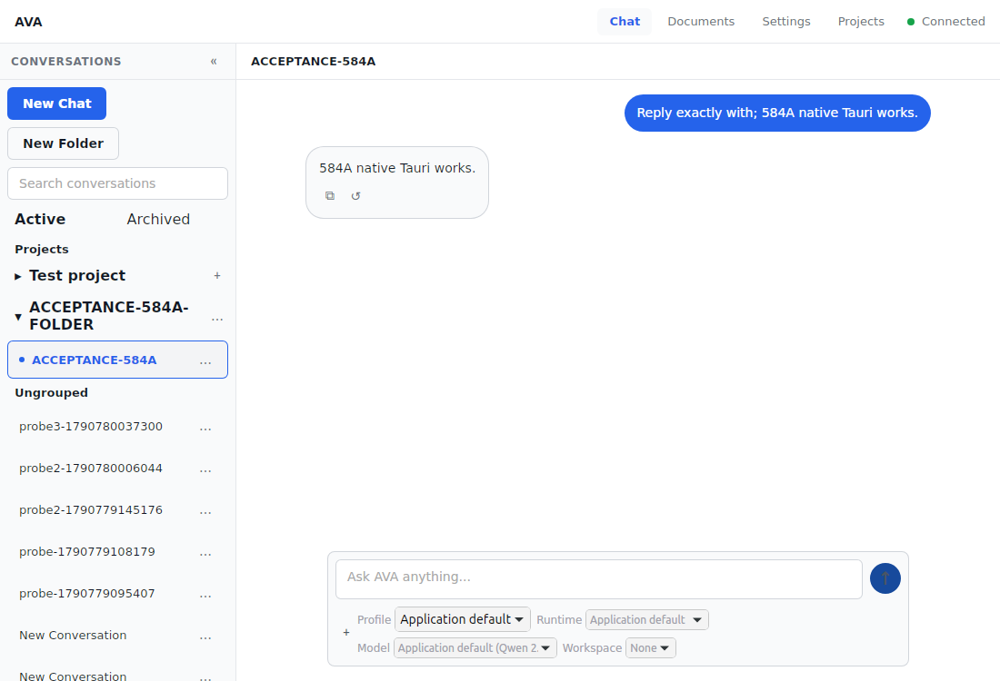
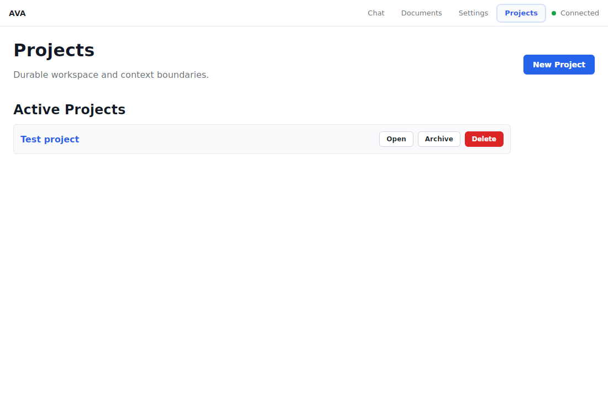
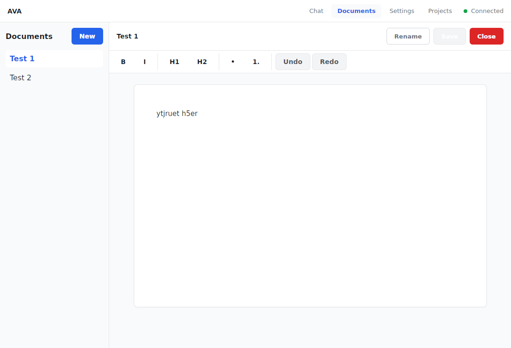
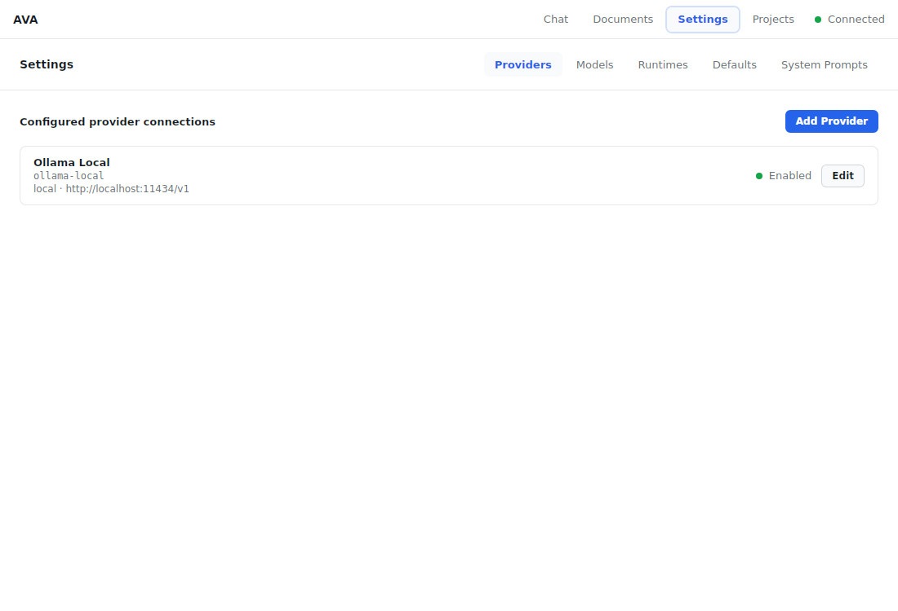
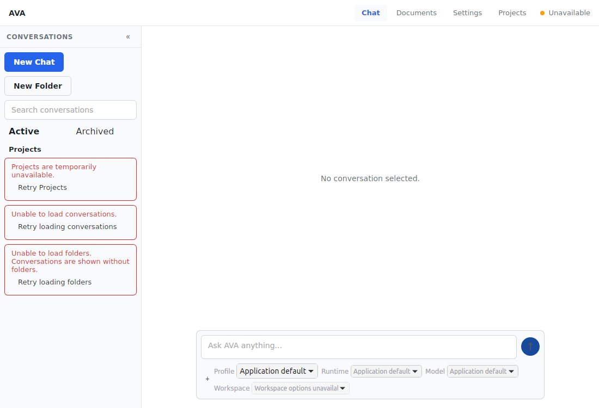
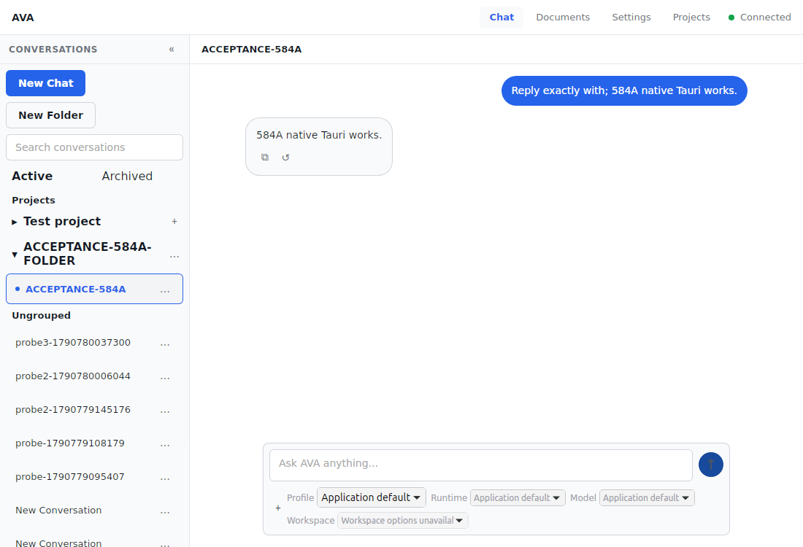
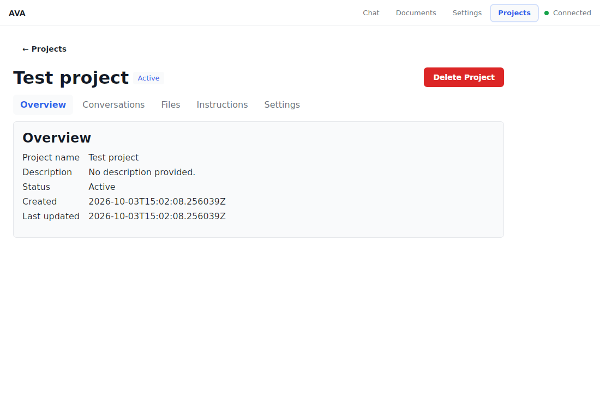
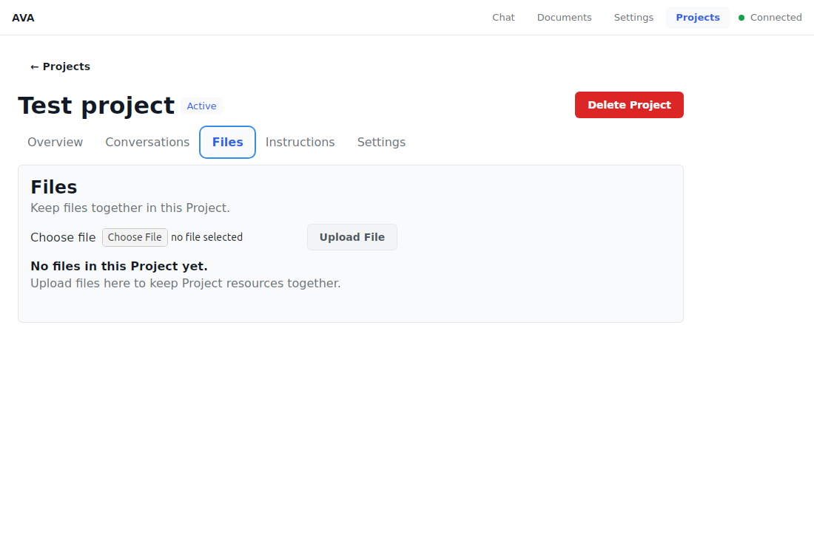
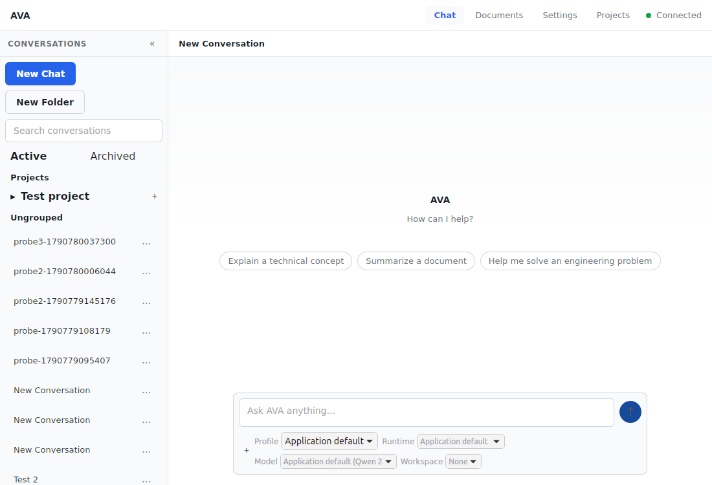

# Phase 5.84A — Native Tauri Acceptance Closure

**Status: COMPLETE. Native Tauri acceptance complete. Phase 5.85 was not started.**

This closes the native-shell acceptance gap left by Phase 5.84. Testing used the actual `ava-desktop` Tauri process and X11 window; the Desktop Vite page was not counted as native evidence. No product feature or separate Desktop state/API path was added.

## Environment and launch

- Repository: `/home/bizon/AvaUi`; Linux GNOME, X11 (`DISPLAY=:1`, `XDG_SESSION_TYPE=x11`, no `WAYLAND_DISPLAY`).
- Canonical backend: `./scripts/dev_backend.sh`, API at `http://127.0.0.1:8000`. `/health` returned `healthy`; `/capabilities` returned contract version `v1`.
- Canonical native development command, confirmed in `frontend/apps/desktop/package.json`: `pnpm --filter @ava/desktop tauri dev`.
- Tauri config uses `http://localhost:5174` for the Desktop Vite dev server and `../dist` for release assets. `frontend/apps/desktop/src/App.tsx` defaults to the shared API at `http://localhost:8000`.
- During development acceptance, `target/debug/ava-desktop` (with its WebKitWebProcess) owned the visible 1100×750 `AVA Desktop` window. `wmctrl` found the window; AT-SPI (`pyatspi`) enumerated and activated actual WebView controls. This overcame the CUA app inventory's empty native-app list.
- Backend logs showed native WebView requests for health, conversations/messages, Projects, Project Files, Project defaults, Documents, providers, models, runtimes, defaults, and CORE prompts, returning 200 while online. The intentional outage produced retryable failures, not false empty state or an infinite spinner.

## Native workflows

| Area | Result |
| --- | --- |
| Chat and existing data | PASS — native Chat opened existing conversations, including `Test 1` and `Test 2`. The existing `Test 1` document and transcript were read without edits. |
| New Chat and streaming | PASS — created disposable `ACCEPTANCE-584A`, sent `Reply exactly with: 584A native Tauri works.`, and observed the single streamed response in the native conversation. |
| Rename and search | PASS — renamed the disposable Chat through native UI and exact search found/selects it. The final title persisted in SQLite. |
| Archive and restore | PASS — native archive moved it out of Active into Archived; restore returned it to Active with transcript and Folder link preserved. |
| Folder and menu move | PASS — native UI created `ACCEPTANCE-584A-FOLDER`; conversation menu moves to Folder, Ungrouped, then Folder again persisted the expected `folder_id`, without changing Project membership. |
| Pointer drag | NOT VERIFIED — attempted in the native shell, but the association did not change. Shared dnd-kit pointer behavior is covered by the Phase 5.84 Web acceptance; no native drag pass is claimed. |
| Projects | PASS — existing `Test project` loaded in the native list and opened. Overview, Conversations, Files, Instructions, and Settings tabs rendered. Files showed its empty state; Instructions and Settings retained existing defaults. |
| Documents | PASS — existing `Test 1` and `Test 2` appeared; `Test 1` opened with its stored content visible. |
| Global Settings | PASS — Providers, Models, Runtimes, Defaults, and System Prompts each opened and loaded read-only. No user setting or credential changed. |
| Native Project File download | NOT RUN — the existing Project had no Project Files to download. Its Files view was opened and verified empty. |

Screenshots below are captures of the native Tauri window, not Vite browser pages:

| Capture | Evidence |
| --- | --- |
| Chat and streamed transcript |  |
| Project list |  |
| Project workspace |  |
| Documents with Test 1 open |  |
| Global Settings |  |
| Built release with backend offline |  |
| Built release after native Retry recovery |  |
| Built release workspace |  |
| Built release Files view |  |
| Built release after clean restart |  |

## Outage and restart acceptance

The first native development window opened with the backend healthy. With that window left running, the backend was stopped: Projects showed its explicit unavailable/Retry state. After `./scripts/dev_backend.sh` restarted the backend, native Retry recovered Projects without refreshing or restarting Tauri. The application remained responsive.

For Desktop-before-backend acceptance, Tauri was closed normally and relaunched while the backend was stopped. The new native WebView rendered the shell with distinct retry controls for Projects, Conversations, and Folders; it did not remain on a spinner or report empty data. Starting the backend and clicking those native controls recovered the data in place. A second normal close/relaunch succeeded and reconstructed the acceptance transcript, Folder membership, existing Project, existing Documents, and composer state from the backend.

The release binary at `frontend/apps/desktop/src-tauri/target/release/ava-desktop` was then launched directly. It created a visible native window and loaded the Chat transcript. With the backend stopped, it showed the same retryable errors; after canonical backend restart, all three Retry controls recovered and the existing data returned. Its Project workspace and Files route also loaded. After test-fixture cleanup, a fresh release launch showed existing `Test project`, `Test 1`, and `Test 2`, with no acceptance fixture or retry control.

Normal window close ended the native process. Closing the Tauri development window also ended its development command and Desktop Vite helper, which matches the current dev-stack lifecycle. A second release instance was launched while one was open; two separate native windows/processes appeared, confirming current behavior has no single-instance guard. The extra test instance was closed normally.

## Build, defect, and validation

The initial all-target Tauri build compiled the release executable and DEB/RPM bundles, then AppImage bundling failed because the bundle configuration did not explicitly list an app icon. The repository already contains `icons/icon.png` at 512×512. `frontend/apps/desktop/src-tauri/tauri.conf.json` now points Tauri at that existing square icon; no new asset or runtime behavior was added. The canonical `pnpm --filter @ava/desktop tauri build` then passed and generated the executable plus DEB, RPM, and AppImage artifacts. The initial packaging failure is resolved; no acceptance-blocking native runtime defect remains.

| Check | Result |
| --- | --- |
| `@ava/desktop` tests | PASS — 11 passed. |
| `@ava/agent-ui` | PASS — 294 passed. |
| `@ava/workspace` | PASS — 209 passed, 6 skipped; 2 integration test files skipped. |
| `@ava/api-client` | PASS — 112 passed. |
| `@ava/contracts` | PASS — 42 passed. |
| `@ava/document-core` | PASS — 70 passed. |
| `@ava/settings-core` | PASS — 209 passed. |
| Focused backend rerun | INCOMPLETE — the first invocation was terminated after limited progress; a retry emitted one progress marker and made no further progress for over a minute, so it was interrupted. Phase 5.84's prior focused backend record remains 133 passed, 3 skipped, including archive, delete/cleanup, restart durability, migration, CORE, Project defaults, and Project Files. |
| Canonical aggregate backend harness | NOT REPEATED — Phase 5.84 documented the known stall at `tests/test_attachment_restart_recovery.py` across the TestClient/loopback restart boundary. |
| TypeScript / Web build | PASS — `pnpm --filter @ava/web build`; existing large-chunk warning only. |
| Desktop build | PASS — `pnpm --filter @ava/desktop build`; existing large-chunk warning only. The Tauri command also ran its `beforeBuildCommand` build. |
| Native Tauri build | PASS — `pnpm --filter @ava/desktop tauri build`; executable and all three Linux bundles produced. |
| Built-artifact launch | PASS — direct release executable launch, native Chat, Project workspace, outage/retry, restart and clean-state reconstruction. |

No native WebView console interface was available. Native stdout showed no app startup/runtime error; the native window rendered and accepted controls, and backend logs corroborated its successful requests. The intentionally stopped API was the only observed runtime failure. A full browser console capture, native pointer drag, Project File download, and Documents/Settings-specific outage clicks were not performed. These checks do not leave a BLOCKER or MAJOR acceptance defect; broader Web behavior and the shared package tests remain documented in Phase 5.84.

## Cleanup and preserved state

Removed only conversation `cffa1713-5a93-4715-aa7c-9b23d55fae62` (`ACCEPTANCE-584A`) and Folder `f832bf32-20fb-479f-b533-a0a686bff56e` (`ACCEPTANCE-584A-FOLDER`) through AVA's API; both returned HTTP 204. Final live SQLite state: schema migration 18, 11 conversations, 0 folders, 1 Project, 2 Documents. No `ACCEPTANCE-584A*` records remain. The existing `Test project`, `Test 1`, and `Test 2` rows remain. `PRAGMA integrity_check` returned `ok`.

The only production file changed for this closure is `frontend/apps/desktop/src-tauri/tauri.conf.json` to declare its already-existing square icon. No production regression test was added because no runtime code changed. `git diff --check` passed. The complete parent Phase 5.84 status and this closure are recorded in [AVA_Phase_5_84_Web_Desktop_Acceptance_Pass.md](AVA_Phase_5_84_Web_Desktop_Acceptance_Pass.md) and the Phase 5 index.

**Phase 5.84A complete. Native Tauri acceptance complete. Phase 5.84 complete. Web + Desktop acceptance passed. No Phase 5 BLOCKER or MAJOR acceptance defects remain. Phase 5.85 not started.**
