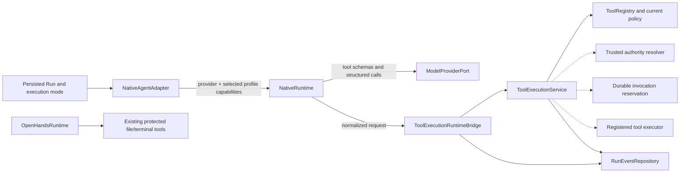

# AVA Phase 6.12 — Agent Runtime Integration

## Outcome and status

Phase 6.12 adds provider-neutral structured tool calls to AVA's model
contracts, a bounded tool-calling loop in the Native runtime, and a runtime
bridge that routes normalized requests through the existing
`ToolExecutionService`. It also applies Chat/Plan/Agent restrictions to
OpenHands' existing file and terminal tools and records safe tool lifecycle
events. The integration preserves the central execution service as the only
dispatch boundary.

The integration is **PARTIAL — runtime foundations and focused acceptance
tests pass; production dispatch and approval continuation remain unavailable**.
Production composition has no trusted tool-authority issuer/context resolver,
executor mapping, or durable invocation reservation adapter. Consequently it
advertises no Native tools and cannot dispatch an unexpected model request.
Approval-required Native operations end as a failed runtime result with an
explicit approval-required marker; no durable wait/resume API exists to
continue the same Run. **Phase 6.12A has not started.**

The supplied Phase 6.12 brief governs this implementation. The locked
canonical plan and historical phase outline were not edited.

## Runtime architecture

The dashed-by-availability dependencies in the diagram (authority,
reservation, and executor) are intentionally absent from production
composition. `api/app.py` wires a `ToolExecutionRuntimeBridge` into the
Native runtime, but does not inject a context resolver. This makes discovery
return an empty list. An unexpected call is submitted with an unavailable
opaque context and denied by the central service; no alternate Native
executor exists.

## Provider-neutral model contracts

`ava.contracts.models` now defines `ModelToolDefinition` and `ModelToolCall`.
`ModelMessage` carries normalized assistant calls and tool replies;
`ModelRequest` carries optional tool definitions; and `ModelResponse` carries
structured calls, including a valid empty-text response when calls are
present. The OpenAI-compatible adapter translates these values at its own
boundary. No vendor SDK schema or response object enters AVA contracts.

The runtime receives both provider capabilities and the selected model
profile's `ModelCapabilities` separately. Native advertises tools only when
both report `tool_calling`, a bridge exists, and the Run is not in Chat mode.
The selected profile's capability is forwarded by `NativeAgentAdapter`; it is
not inferred from provider identity or `ConfiguredModelBinding`. Missing
capability metadata is conservative and disables tool advertisement.

## Native tool loop and limits

`NativeRuntime` discovers definitions through `RuntimeToolBridgePort` and
translates them into model-neutral schemas. Each returned structured call
enters the bridge and receives a normalized tool-role reply matched by the
provider call ID. The runtime does not turn a model-generated call into an
executor invocation itself. Calls that were not advertised are rejected and
recorded without dispatch.

The server owns the loop limits: at most 12 tool requests per Run, 6
tool-call iterations, 3 consecutive failed tool outcomes, and 64 KiB of
serialized result per reply. Oversized replies are replaced with a small safe
failure result. Provider arguments are parsed and validated by the bridge;
duplicate JSON keys and non-finite constants are rejected. Runtime diagnostics
for tool-loop outcomes contain IDs, counts, and reason codes, not raw tool
arguments or outputs. Cancellation reaches the active bridge call through
the runtime's active task.

An `AWAITING_APPROVAL` outcome is not reported as success or silently retried.
The runtime returns a failed result with an approval-required indication.
This phase does not add an approval API, an `awaiting_approval` Run lifecycle
transition for tool calls, a continuation token, or resumption of the same
model conversation. Durable approval continuation remains prerequisite work.

## Central bridge, checks, and events

`ToolExecutionRuntimeBridge` converts a structured call into `ToolRequest`
using AVA's Run ID and a deterministic AVA invocation ID derived from the Run
ID plus provider call ID (a random ID is used when the call ID is absent).
Model call IDs are correlation inputs, not authorization evidence. The bridge
strictly parses arguments, resolves an opaque context reference only through
an optional trusted resolver, and sends requests to `ToolExecutionService`.

The execution service reads the persisted Run mode and applies current Run,
feature, tool classification, authority, Workspace, policy, approval,
executor, and durable-reservation checks. Discovery is only an eligibility
filter and dispatch repeats its security checks. Chat is denied. Plan admits
only structurally classified reads with no effects beyond `FILE_READ`.
Unknown classifications and commands remain denied. Agent mode does not
bypass policy or approval. Discovery also requires an executor and durable
reservation, so production's current empty executor mapping returns no tools.

Tool request, rejection, start, and outcome events carry invocation ID, tool
ID/version, persisted execution mode, status, and an optional safe reason code.
They omit model arguments, result payloads, Workspace paths, and provider
objects. The service records `TOOL_STARTED` after reservation and immediately
before executor entry; it records terminal outcomes for completion, failure,
indeterminate finalization, and cancellation. Event persistence is best-effort
and does not create dispatch authority.

## OpenHands compatibility boundary

OpenHands remains on its pre-existing tool path; it is not bridged into
`ToolExecutionService` in this phase. Its `FileEditorTool` and controlled
terminal retain the existing Workspace authorization policy, opaque security
context, and command sandbox. Chat receives no legacy tools. Plan can receive
only the read-only FileEditorTool and never the terminal. Agent retains the
legacy policy-controlled file and terminal behavior. This is an explicit
integration gap: the new normalized discovery, invocation reservation, event
and durable approval path does not govern OpenHands legacy operations. The
legacy path's existing protections remain active, and Phase 6.12 does not
claim unified enforcement across both runtimes.

## Persistence, restart, and portability

The Run remains the durable source of execution mode. Tool lifecycle events
use the existing Run event repository. There is no new persisted tool-call
queue, provider call state, or resumable tool loop, so a process restart cannot
resume an in-flight model/tool exchange. The durable reservation contract is
still required before production dispatch; in-memory runtime task tracking is
only for active cancellation and is not restart durability.

Core contracts, policy, runtime bridge, and event payloads are Python/JSON
contracts and do not branch on host OS. OpenHands host-specific execution
continues to use existing platform adapters. Native filesystem behavior stays
behind the previously validated Linux and Windows infrastructure adapters.
This phase adds no cloud storage provider or cloud-host-specific trust.

## Deferred prerequisites and next-phase boundary

Before production tool dispatch can be enabled, AVA still needs a trusted,
per-Run authority/context resolver; production executor registration; a
durable invocation reservation adapter with restart-safe state; and a
durable human approval identity, API, and Run continuation/resumption design.
The OpenHands legacy path also needs a separately designed migration if both
runtimes are to share normalized dispatch and audit semantics. These are
prerequisites, not implicit permission to enable production dispatch.

Phase 6.12A is deferred. No integration with a live external agent service,
production dispatch enablement, or new phase implementation was started.

## Validation evidence

- Phase 6.12 contracts, provider translation, Native tool loop, bridge,
  OpenHands mode rules, runtime port/registry, execution selection,
  multimodel integration, and non-lifespan composition selections: **60
  passed**.
- Existing tool execution, authorization, security matrix, approval, event,
  Run lifecycle, and RunService suites: **194 passed**.
- Selected Run recovery compatibility and authority tests: **7 passed**; 9
  unrelated recovery cases were deselected.
- Ruff across `backend/src/ava` and the changed Phase 6.12 and adjacent backend
  tests: **passed**.
- Strict mypy across all 287 `src/ava` files: **passed**.
- Frontend contract typecheck was not run: the installed workspace lacks the
  TypeScript executable under the broken `node_modules` link, so no frontend
  compiler result is available.
- App startup/TestClient validation was not completed. The selected
  `test_composition_and_startup_require_no_network` test stalls in this
  environment; the same baseline startup test was observed to stall before
  Phase 6.12 changes. The bounded, non-lifespan composition tests passed.
- Existing OpenHands end-to-end tests that launch the local bubblewrap runner
  are host-limited: one fails because this container cannot create the required
  `NETLINK_ROUTE` socket, and another SDK conversation test stalls. The new
  isolated OpenHands mode tests pass. No Windows or cloud CI was run for
  Phase 6.12.

**Phase 6.12 status: PARTIAL — implementation and focused checks pass; live
dispatch, durable approval continuation, unified OpenHands enforcement, and
Phase 6.12A remain deferred.**
