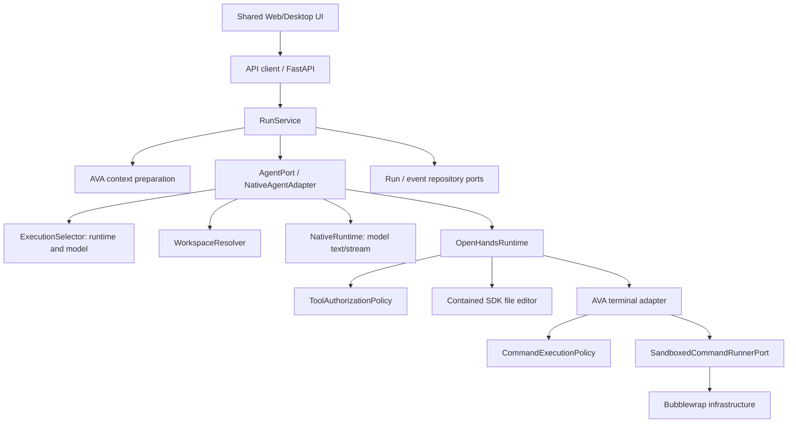
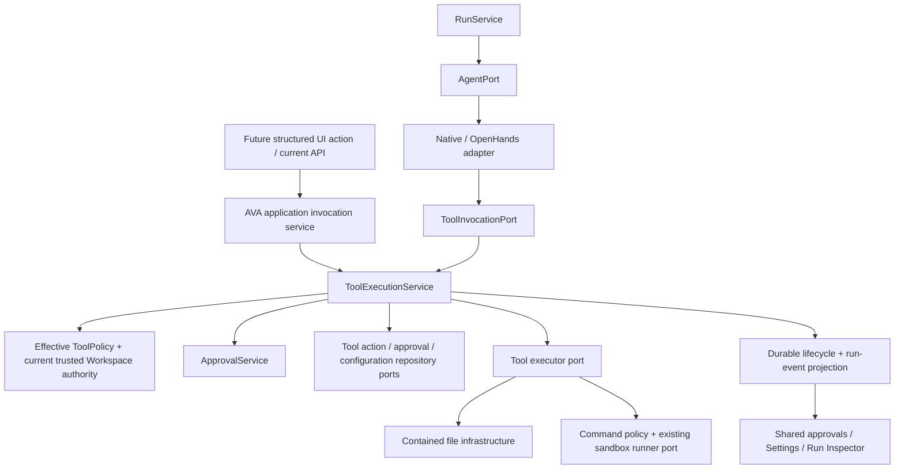

# AVA Phase 6.1 — Architecture Audit and Implementation Design

Date: 2026-10-12  
Scope: inspection, design recommendations, and this report only. No Phase 6 production implementation.  
Readiness: ready for bounded Phase 6.2 contract design, subject to the decisions and evidence limits below; not certified for privileged tool rollout.

## 1. Executive summary

**Confirmed:** AVA has an executable OpenHands tool path, server-owned Workspace bindings, file containment/read-only checks, a runtime-neutral command policy, and a Bubblewrap runner. Native AVA's runtime is currently a text-generation/streaming runtime, not a tool-calling executor. An AVA-wide tool registry, persistent feature gates, approval service, durable tool-action lifecycle, and shared approval UI do not exist.

The central recommendation is one AVA-owned tool execution service reached through a narrow invocation port by both runtimes and future structured application actions. The service must own current policy evaluation, approvals, durable action claims, and revalidation before effects. Runtime adapters translate calls/results; they must not import application services or repositories. Preserve `RunService -> AgentPort`, execution precedence, attachment context, compaction, and historical inspection.

Three integration issues require explicit design: running runs cannot currently transition to waiting-for-approval; startup fails all stranded active runs; and current path checks do not eliminate validation-to-I/O/mount races. Persistent approvals cannot be implemented merely by adding DTOs or emitting `approval_requested`.

## 2. Authority, method, and documentation discrepancies

Read the owner-locked [master plan](AVA_MASTER_CANONICAL_DEVELOPMENT_PLAN_LOCKED.md), [Phase 6 outline](AVA_PHASE_6_IMPLEMENTATION_OUTLINE.md), [Workspace addendum](AVA_PHASE_6_USE_CASE_WORKSPACE_ADDENDUM.md), root `AGENTS.md`/`CONTEXT.md`, `docs/agents/domain.md`, relevant Phase 3 developer/security implementation records, and final Phase 5 validation reports. The final Phase 5 handoff was supplied by the owner as an attachment named `Pasted text.txt`, not located under a final-handoff filename in `docs/`; it was read in this chat. No `docs/adr/` directory was present.

Findings below describe the current working-tree source, including pre-existing uncommitted changes. Source references are repository-relative; named files and symbols were inspected. **Confirmed** denotes inspected code or executed tests; **proposed** denotes future design, not implemented capability. This is not a live model, native Desktop, sandbox penetration, or full-regression certification.

Discrepancies retained explicitly:

| Source | Discrepancy / treatment |
| --- | --- |
| Master plan | Calls itself the single owner-locked roadmap, but its status/version and approval record remain `1.0-review` / pending owner approval. Use its Phase 6 direction for this owner-requested audit; do not claim formal lock-in approval or edit it. |
| Workspace addendum | Says binding architectural rule but also proposed for incorporation. Prepare the fixed-binding seam; do not claim the master was amended or implement use cases. |
| Root `AGENTS.md` | Does not yet contain the master's requested read/owner-lock reference. Record the gap; this request prohibits editing that file. |
| `CONTEXT.md` / Phase 5.85 | Retain schema 21 / earlier schema-18 certification language. Current migration registry reaches 23; October 12 reports supersede earlier final-validation claims. Project as application context must not be confused with agent-execution Workspace. |
| Historical phase numbering | Older plans place Documents at Phase 6 or RAG at other numbers. Current master: Tools/Approvals 6, RAG 7, Use Cases 8, Engineering 9, Documents 10. |
| Runtime/settings docstrings | Native runtime/port comments still say unused in production; Settings comments still describe early read-only phases. Actual composition and management code supersede those comments. |

No discrepancy was silently resolved by editing a source document.

## 3. Existing implementation inventory

| Source and symbol | Confirmed responsibility, contracts, enforcement, and limits |
| --- | --- |
| `backend/src/ava/services/run_service.py` — `RunService.execute_prepared_run`, `cancel_run`, `get_run_inspection` | Durable orchestration through `AgentPort`; content/inspection callbacks, cancellation intent, run/event retrieval. No direct runtime SDK, tool policy, or Workspace resolver imports. No generic tool invocation/event callback on the agent interface. |
| `backend/src/ava/agents/contracts.py` — `AgentPort`, `AgentRunResult` | AVA-owned agent start/stream/cancel boundary. Accepts prepared context and an optional resolved-execution value (execution type imported under `TYPE_CHECKING`). No approval continuation contract or tool execution port yet. |
| `backend/src/ava/agents/adapters/native/native_agent.py` — `NativeAgentAdapter._start_run`, `_resolve_workspace`, `_bound_context`, `_context_limit` | Routes to the selected runtime/model, binds a registry-approved Workspace, captures inspection, and retains context-fitting policy. The class name does not mean every run uses `NativeRuntime`; it also dispatches OpenHands. Unknown requested Workspace fails; no requested Workspace yields no binding. |
| `backend/src/ava/runtimes/adapters/native/native_runtime.py` — `NativeRuntime.execute`, `execute_streaming`, `cancel_run` | Provider-neutral generation and streaming with task cancellation. Workspace is explicitly ignored (`del workspace`); runtime capabilities default false. No file operations, command dispatch, tool request/result loop, or approvals. Registered by production composition despite stale docstrings. |
| `backend/src/ava/runtimes/adapters/openhands/openhands_runtime.py` — `OpenHandsRuntime.execute`, `cancel_run` | SDK execution with explicit AVA tools, approved binding, configured provider identity, and system/user-context translation. SDK work runs through `asyncio.to_thread`. Cancellation revokes the run's controlled tools, but can leave SDK worker execution alive. SDK request capture explicitly excludes defaults/provider wire payload. |
| `backend/src/ava/runtimes/adapters/openhands/file_policy.py` — `build_openhands_tools` | Adapts AVA activation decisions to SDK specs. Only `file_editor` and `ava_terminal`; missing policy/capabilities/Workspace fail closed. Terminal additionally requires composed command policy/runner. SDK types remain adapter-local. |
| `backend/src/ava/runtimes/adapters/openhands/file_tools.py` — `ContainedFileEditor`, `ContainedFileEditorExecutor`, `AvaFileEditorTool` | Real installed SDK editor under a resolved root. Supports view, create, string replacement, insertion, undo; deletion is denied. Enforces read-only, 10 MiB bounds, regular-file/hard-link checks, canonical traversal/symlink containment and filtered listings. Checks are path-based; no descriptor-anchored atomic containment. Executor checks run revocation before invoking the editor. |
| `backend/src/ava/runtimes/adapters/openhands/controlled_terminal.py` — `AvaTerminalExecutor`, `AvaTerminalAction` | Structured executable/arguments/cwd, command policy, sandbox delegation, bounded normalized observations, and active-command cancellation polling. No raw shell/TerminalTool. SDK ToolDefinition is a vendor definition, not the future public AVA ToolDefinition. Runner invocation crosses a worker-thread event loop using `asyncio.run`. |
| `backend/src/ava/runtimes/adapters/openhands/conversation.py` — `ControlledAgent._initialize`, `ControlledConversation` | Restricts accepted specs to two controlled names; suppresses ambient file agents/plugins/hooks/MCP/skills. Private SDK overrides and global SDK registration are compatibility-sensitive. |
| `backend/src/ava/runtimes/adapters/openhands/tool_context.py` and terminal context functions | In-process opaque references keep run/policy objects out of SDK-persisted specs. Runtime releases them in `finally`; not durable approval or restart state. |
| `backend/src/ava/execution/tool_security.py` — `ToolAuthorizationPolicy.evaluate`, `ToolRunContext`, `ToolAuditEvent` | Framework-neutral activation decision using capabilities and server-owned Workspace permissions. Hardcoded two-name allowlist; no persisted enablement or operation-specific approval. Audit is metadata-only, best-effort; production OpenHands defaults to `NoOpToolAuditSink`, not persistent run events. Revocation is a process-local `threading.Event`. |
| `backend/src/ava/execution/command_policy.py` — `CommandRequest`, `SandboxedCommandExecutionPolicy.evaluate` | Read/shell/local-root requirements, contained cwd, bare executable syntax, fixed environment and timeout. Does not execute. `runner_available` permits prepared requests, but exact executable allowlist/network denial are enforced again by the runner. No argument-sensitive risk/approval policy. |
| `backend/src/ava/execution/sandbox.py` — `SandboxedCommandRunnerPort`, request/result/limits | Existing AVA-owned internal contained-command port, not public tool API. Separate CPU/memory/process/output limits, command ID, timeout, cancellation and result reasons. Reuse rather than introduce another sandbox interface. |
| `backend/src/ava/infrastructure/sandbox/bubblewrap_runner.py` — `BubblewrapSandboxedCommandRunner` | Real subprocess adapter. Namespace isolation, approved root mounted read-only/read-write, minimal environment, executable allowlist, bounded output, timeout and process-group termination. Network=true denied. Read-only `/usr` plus private dev/proc/tmp are mounted; host home and backend environment are not inherited. Availability checks binary presence, not a successful sandbox startup. Linux-specific; no host-shell fallback. |
| `backend/src/ava/workspaces/{contracts,registry,resolver}.py` — `WorkspacePermissions`, `ResolvedWorkspace`, `RuntimeWorkspaceBinding`, `WorkspaceRegistry`, `WorkspaceResolver` | Separate read/write/shell/network false-default grants, opaque identities, pure binding mapping and registry lookup. Registry is in memory with register/get/list only; no durable provisioning, update/revoke revision, caller ACL, or administrator workflow. |
| `backend/src/ava/infrastructure/composition.py` / `api/app.py` | Register Native/OpenHands; inject policy and optional runner into OpenHands. Create empty Workspace registry shared with discovery/resolution. No automatic production-repository grant, global tool feature setting, or persistent audit sink. |
| `backend/src/ava/services/workspace_discovery_service.py` — `WorkspaceDiscoveryService.discover`; `api/routes/workspaces.py` | Public identity/display/kind only; no root/permissions exposed. Discovery is not per-caller authorization. `RunRequest.workspace_id` is a client selection of a registered ID, not a client-supplied permission grant. |
| `backend/src/ava/contracts/approvals.py` | Docstring-only placeholder. No ApprovalRequest/Decision implementations. |
| `backend/src/ava/contracts/events.py` / `responses.py` | Tool started/progress/completed and approval_requested enum values, plus waiting_for_approval status exist. Tool request/failure/denial/approval-decision lifecycle and typed payloads are absent; enum presence is not execution support. |
| `backend/src/ava/services/run_lifecycle_service.py` — `ALLOWED_TRANSITIONS`, `RunLifecycleService` | Central CAS-guarded state changes and durable cancellation. Pending can wait for approval; running cannot. Waiting->running maps to RUN_STARTED; no waiting event. Status write/event append are not one cross-repository atomic transaction. |
| `backend/src/ava/services/run_recovery_service.py` — `recover_stranded_runs` | Fails all durable active runs with execution_interrupted; does not resume SDK tasks or retain approval waits specially. |
| `backend/src/ava/repositories/run_event_repository.py`, `services/run_event_store.py`, relational event adapter, `api/routes/runs.py` | Existing append/order/exclusive-sequence replay, SSE observation, cancellation and inspection routes. Useful transport and history; not a tool action repository or exactly-once side-effect mechanism. |
| `backend/src/ava/services/settings_service.py`, `api/routes/settings.py`, configuration repositories | Persistent provider/model/runtime/default management with AVA contracts and memory/SQLite adapters. No Tool settings resource; runtime enabled is not tool enabled. No enterprise identity/admin permission enforcement in inspected application routes. |
| `backend/src/ava/infrastructure/persistence/{composition,database}.py` and migration registry | Existing repository wiring, shared locked SQLite transactions, memory alternatives, ordered migrations through v0023. No tool/approval tables. No active developer database was opened for this audit. |
| `backend/src/ava/contracts/models.py` — `ModelRequest`, `ModelResponse`, `ModelMessage` | Text-oriented messages/request/response; `tool_calling` is capability metadata only. No normalized tool schemas/calls/call IDs/results. Native model-backed multi-step tools require deliberate additive model-port evolution, not parsing arbitrary prose as authorized actions. |
| `frontend/packages/agent-ui/src/run/runEventProcessor.ts` | Processes message/run events; tool/approval events currently fall through to ignore. No approval interaction state. |
| `frontend/packages/workspace/src/RunInspector.tsx` | Existing historical prompts/request/response/run/events and attachment display, stale-response guards, retry and polling. Events can display generic payloads; no structured tool-action/approval UI. |
| `frontend/packages/settings-core/src/settings/{SettingsWorkspace,SettingsSectionNav}.tsx`, state hooks/inventory/modal | Shared Settings navigation, resource generation guards, retry/forms and management primitives. Reusable presentation; no tool/Workspace management section. |
| `frontend/packages/{contracts,api-client}/src` / `clients/python/src/ava_client/models.py` | Contract mirrors and shared API transport. No normalized tool/approval client surface. Existing Python client does not mirror every resource family; define intentional parity for new supported operations. |

## 4. Reusable components and missing components

Reuse Workspace identities/permissions and binding semantics, controlled SDK adapter boundaries, `ToolAuthorizationDecision` reason-code conventions, `CommandExecutionPolicy`, `SandboxedCommandRunnerPort`, contained-command infrastructure, migration/repository patterns, CAS lifecycle operations, run-event sequencing/SSE, inspection sanitization, and shared Settings/UI primitives.

The contained editor is useful behavior/reference coverage, but its SDK superclass must not become AVA's runtime-neutral file backend. Extract or replace the minimal file implementation behind an AVA execution port when implementing 6.9; keep SDK action/observation translation at the edge. Existing `ToolAuthorizationPolicy` should be generalized/delegated to the new effective policy, not left as a competing permission authority.

Missing: AVA tool schemas/registry; feature-gate persistence; trusted Workspace authority provisioning/revision and caller context; operation-specific policy; durable tool action/approval records; decision routes and UI; authorization bound to exact request/resources; non-chat invocation; structured Native tool protocol/loop; normalized lifecycle production; crash/duplicate/cancellation/revocation coordination; tool-specific Inspector rendering.

## 5. Dependency diagrams

Confirmed current path:

Proposed dependency direction (arrows mean invocation through AVA interfaces; concrete services/implementations are wired in composition):

The diagrams do not imply runtime imports of services, database access by adapters, or security policy owned by RunService.

## 6. Security boundary assessment

| Boundary | Confirmed assessment / Phase 6 requirement |
| --- | --- |
| Runtime/provider/model separation | Registries/resolvers, stable model binding and execution selector remain separate. Existing guards pass. Capability affects compatibility/activation but Workspace permissions provide separate grants. Preserve model/provider selection as descriptive, not authoritative. |
| Workspace selection | Unknown IDs deny and roots come from trusted registry. However any registered ID is resolvable without a caller ACL. This is a local server-provisioned model, not per-user/per-use-case authorization. Future assigned binding must supersede untrusted client workspace selection. |
| Filesystem | Static traversal/symlink escapes, read-only writes, hard links/special files and size are checked. Validation before SDK I/O leaves race exposure; canonical resolution alone is not race-proof. Require operation-time descriptor/root anchoring or equivalent contained execution and hostile-race tests before claiming that property. |
| Commands | No host shell, no arbitrary executable path, minimal environment, network denial and contained mount. Python is allowlisted with arbitrary arguments: executable allowlisting is not command semantic safety. On a writable root Python can mutate/delete resources; file_editor's delete denial is not a global no-delete guarantee. Future approval/risk policy must cover command-mediated effects too. |
| Network | Controlled terminal rejects network-enabled requests and uses isolated namespaces. Model/provider inference intentionally uses configured endpoints; it is a separate approved transport, not evidence tools have network authority. No general network tool exists. |
| Credentials/data | Tool command environment does not inherit AVA/provider secrets; public Workspace discovery hides paths. Approved readable Workspace files can contain sensitive data, and model calls can transmit permitted context. Do not register secret-bearing roots or claim blanket secret exclusion. Existing key-based inspection redaction is not complete content DLP. Exception logging in file/terminal/runtime uses logger.exception; review path/content leakage before expanding tool logs. |
| Cancellation/revocation | Run-local revocation prevents later adapter calls and polls active commands. A file effect already past its initial revocation check may finish; SDK worker threads may survive cancellation. No durable gate/Workspace revision revocation today. |
| Gates/approvals | No centrally persisted tool-disable or approval decision enforcement. Tools activate automatically for sufficiently permissioned registered Workspace and runtime. Empty registry currently limits default exposure; this does not satisfy Phase 6 feature-gate requirements. |
| Administration | Settings routes are not an enterprise auth/admin system. A label or frontend switch cannot prove authorized management. Define a trusted local administrative/caller authority seam without importing full Phase 12 identity; fail closed where authority is missing. |

No direct SDK/service/repository dependency violation was found by the executed architecture module. Guards do not prove all behavioral security properties, nor do they catch adapter-local context-fitting ownership debt.

## 7. Recommended tool and approval architecture (proposed)

Use one registry of trusted implementation identities and immutable/versioned definitions, separate from mutable persisted enablement/configuration. `ToolDefinition` should describe stable ID, version, input/output schema, capability requirements, risk/mutation characteristics and limits; registration/metadata never grants authority.

`ToolRequest` should identify the action, definition version and validated arguments with optional run/correlation identity. A public request may express intent, but cannot carry effective permissions, trusted filesystem roots, administrator identity or an approval=true grant. `ToolExecutionContext` is an internal server-produced capability value: effective Workspace identity/revision, caller-authority reference, cancellation/revocation handle and policy/gate revisions. Paths stay private to execution infrastructure.

`ToolResult` should have explicit succeeded/failed/denied/cancelled outcomes, safe error codes, bounded typed output/artifact refs and execution identity. Reserve an explicit indeterminate effect outcome for crash reconciliation where success cannot be established. Keep internal results separate from redacted public views when necessary.

`ToolPolicy` evaluates platform master gate AND individual tool gate AND caller allowlist AND Workspace/resource permission AND implementation capability AND mandatory approval rules. Future use-case allowlists may only narrow this intersection. Approval cannot override a failed containment, disabled tool, unsupported sandbox or missing resource authority.

`ToolExecutionService` is the single dispatcher: validate schema/version -> create durable request -> evaluate current policy -> request/await approval if needed -> revalidate -> atomically claim action -> execute through port -> persist outcome -> publish durable facts. Keep adapters from reaching executor backends directly. The service must be invocable without a Conversation; optional run association projects events into existing Run history. Non-run actions still require their own durable identity/history and cancellation scope.

`ApprovalService` owns a distinct durable decision state machine. Bind each approval to an immutable canonical payload/digest, tool version, operation ID, resources/expected content version, Workspace assignment revision, policy requirements, actor-authority reference and expiry. A changed argument/resource/Workspace/risk requirement needs a fresh decision. Decision endpoints receive a decision intent and server-authenticated authority, not a caller-supplied approver claim.

Keep the model protocol distinct from the tool protocol. Native model requests/responses need explicit tool definitions, call IDs, structured arguments, results and loop bounds when 6.10 supplies model-driven tools. Do not execute free-text pseudo-tool calls. Map OpenHands schema and results into the same invocation port; suppress its direct raw/legacy executor path once normalized execution is enabled. Prove `file.read` through Native AVA and OpenHands first, then broaden effects with approvals.

## 8. Feature-gating recommendations (proposed)

Persist master availability=false and per-tool enabled=false in an AVA-owned settings resource, with validated typed configuration and monotonic revision. Unconfigured/new registered tools remain disabled after upgrades; environment/bootstrap values must not silently enable them. Existing sandbox infrastructure detection stays operational capability discovery, not ordinary feature configuration.

Extend shared Settings navigation with Tool Framework / Tools / Workspace Authority and activity views as bounded 6.4/6.5 work. Reuse inventory, modal/form/resource hooks, accessible shared controls and typed API-client transport. Display configured enablement separately from effective availability and safe denial reasons. Changes persist on the server and affect all execution paths; localStorage is not permission authority.

Disable blocks newly requested/claimed execution immediately and invalidates pending grants according to policy revision. Recheck at dispatch even if a stale model/SDK still advertises the tool. Define cancellation/containment policy for already-started actions; do not promise undo of completed writes. Mandatory checks, approval enforcement and historical records are not disableable knobs. Persist and authorize approval-policy edits; no user-supplied executable configuration or arbitrary scripts.

## 9. Workspace integration recommendations (proposed)

Preserve AVA's existing Workspace domain and read/write/shell/network distinction. Extend behind an AVA-owned authority/provisioning port with durable registry data, administrative change control, revisions/revocation and current grant lookup. Do not equate Project/Folder membership, Project File identity, model choice, runtime choice or a selected UI ID with permission.

The future caller-scope seam can accept a trusted fixed Workspace binding without importing use-case entities. Phase 8 may supply its required administrator-assigned workspace_id through that seam; Phase 6 must not add UseCaseDefinition or configurable use-case screens. A regular user cannot replace trusted assigned authority with a RunRequest workspace_id or tool path. Missing/invalid assignment denies resource access.

Administrative Workspace changes invalidate pending approvals/grants bound to the former revision; active operations are cancelled/contained where technically supported. Persist the historical effective identity/scope and revision, with safe public summaries rather than unrestricted roots. Network grant remains independently denied until a real supported network policy/executor exists. Plan/Work, if added in a later authorized step, are execution-policy axes: Plan cannot mutate, Work does not bypass gates or approvals.

## 10. Lifecycle, persistence, recovery and inspection (proposed)

Normalize requested -> approval-required -> approved/denied -> started -> completed/failed, including cancelled, expired and revoked outcomes. Denial may occur before approval. Keep action and approval state authoritative; run events are ordered projections, not the only action store.

Use existing migration and repository patterns with memory/SQLite parity. Add a narrow write coordinator for action/approval state plus durable event/outbox records, modeled on transaction-owning coordinators already in AVA. Current RunLifecycleService writes status before event, leaving a crash gap; do not copy that as an exactly-once guarantee for approvals. Idempotent decision and action claims need CAS/unique identities and replay-safe event projection.

Do not hold a SQLite transaction or worker thread while waiting for a human. Approval waits must release resources/model leases as appropriate and have a continuation contract. An approval click records a decision, not an immediate privileged side effect.

Resolve these lifecycle choices before implementing 6.7/6.10:

- Running->waiting_for_approval and resumption semantics: current transitions reject the first move; waiting->running would emit another run_started. Add intentional pause/resume facts or keep run status running with a distinct waiting action projection. Either choice requires UI/cancellation consistency and tests; no silent state-machine bypass.
- Startup currently fails all active runs, including waiting. Introduce deliberate reconciliation that retains/revalidates safe pending approval/action state, while not claiming SDK checkpoint/resume support. If an interrupted run is terminal, its pending actions cannot execute merely because a later approval arrives.
- Never automatically replay a started write/delete/command after crash. Reconcile receipt/resource versions or mark indeterminate; require a new user-authorized attempt when effect identity cannot be proven. Exactly-once external side effects are not provided by SQLite alone.
- Cancellation is durable intent; denies new claims, cancels pending approvals and attempts active-command termination. A completed effect stays historical truth even when cancellation races it.
- Permission/gate/Workspace/approval revocation and expiry are checked again immediately before effects. Request validation alone is insufficient.
- Timeouts distinguish human decision expiry from execution timeout; retries create new attempt identities and do not reuse stale approvals accidentally.

Use existing run-event sequence/replay/SSE for associated actions and snapshot/history APIs for reconstruction. Extend additive tool payload contracts and Inspector typed summaries. Existing frontend event processor ignores tools/approvals, so add a shared keyed projection and approval panel; preserve stale-generation/run ownership guards. Store only necessary safe input/output/history; apply explicit size/redaction/retention rules rather than persist every command output indefinitely. Define conversation-delete cleanup for associated actions and separate retention for standalone actions; backups remain a separate governance concern.

## 11. Proposed implementation locations

These paths are suggestions, not created files. Prefer extending the named existing interfaces when safe rather than parallel systems.

| Concept | Proposed location / integration |
| --- | --- |
| Public definitions/requests/results/errors/events | `backend/src/ava/contracts/tools.py`; extend existing `contracts/events.py` and empty `contracts/approvals.py` |
| ToolExecutionContext, invocation/executor ports, definitions registry, pure effective ToolPolicy | `backend/src/ava/tools/{contracts,registry,policy}.py`; adapt existing `execution/tool_security.py` into this single policy flow |
| ToolExecutionService / ApprovalService | `backend/src/ava/services/tool_execution_service.py`, `approval_service.py`; runtime imports only invocation contracts, never these implementations |
| Tool configuration / Workspace authority management | `services/tool_settings_service.py`; existing Workspace package plus authority port; reuse Settings routes/patterns without giving SettingsService execution responsibility |
| Durable settings/actions/approvals/Workspace ports | `backend/src/ava/repositories/{tool_configuration_repository,tool_action_repository,approval_repository,workspace_repository}.py` and narrow write-coordinator port as needed |
| Memory/SQLite implementations and migrations | Existing `services/*_store.py`, `infrastructure/persistence/repositories/`, migration registry after v0023; infrastructure owns transactions |
| Runtime-neutral file effects | `backend/src/ava/infrastructure/tools/file_executor.py` implementing executor port; existing sandbox port/runner retained for commands |
| API | `backend/src/ava/api/routes/tools.py`, `approvals.py`, additive Settings/Workspace routes; call services, not SDKs/executors |
| Composition/runtime integration | Existing `api/app.py`, `infrastructure/composition.py`, Native/OpenHands adapters; inject narrow tool invocation capability |
| Frontend wire/client | `frontend/packages/contracts/src/{tools,approvals}.ts`; `api-client/src/{tools,approvals}.ts` and Settings methods |
| Shared UI | Settings-core tool sections; agent-ui normalized tool/approval projection and shared presentation; workspace Inspector integration; ui-core primitives reused |
| Python client | Existing client/models for the deliberately supported tool/approval API; keep backend/TS/client contracts synchronized |

The current architecture guard allows only named AVA imports in runtime adapters and repository ports. Add narrowly scoped allowances for new AVA ports, preserving bans on concrete services/repositories/vendor leaks. The schema guard currently forbids approval/audit vocabulary and asserts an exact Phase 5 schema; evolve it at the approved persistence step to allow implemented Phase 6 tables, not by deleting its assertions. Its restriction does not block contract-only 6.2 work.

## 12. Risks, decisions and bounded remaining sequence

Highest risks: a second bypass executor path; approval replay against changed arguments/resources; startup executing an interrupted side effect twice; untrusted Workspace override; command-mediated mutation escaping operation-specific policy; path races; administrative Settings bypass; SDK worker lifetime and vendor-private overrides; tool outputs overrunning model budgets or exposing data. The two execution paths must share enforcement, not merely a matching DTO name.

Context-window fitting remains in NativeAgentAdapter despite upstream prompt/summary preparation. When adding tool-result messages, use one AVA budgeting policy for both paths; do not introduce runtime-local history truncation. A bounded extraction of remaining preparation is appropriate only where tool integration requires it, not a wholesale refactor.

Recommended sequence preserves the outline:

| Step | Bounded outcome / dependency |
| --- | --- |
| 6.2 | Contract design and focused validation only: identities/schema versions, safe outcomes, internal authority/invocation ports, lifecycle/payload/approval binding vocabulary. Resolve wire vs internal separation and compatibility. No execution or migrations. |
| 6.3 | Trusted tool registry/discovery with read-only first definition; registration is not permission. |
| 6.4 | Durable false-default master/per-tool settings and shared controls; direct service/API/runtime policy denial proven before advertising enablement. |
| 6.5 | Tool configuration/risk/unavailability/activity UI over real resources. |
| 6.6 | Effective permission intersection, trusted Workspace authority revisions and containment strategy; no use-case entities. |
| 6.7 | Durable approval/action foundations, exact binding, idempotency, revocation/expiry/cancellation and restart decisions. Minimal persistence must land here, before approvals are called durable. |
| 6.8 | Authorized shared approve/deny UI with refresh/retry/stale-selection tests. |
| 6.9 | One dispatcher and initial file/command executors; positive/negative tests, race/side-effect revalidation, no legacy bypass. Expand one effect at a time. |
| 6.10 | Native structured tool loop and OpenHands translation; same file.read contract through both, then bounded multi-step/mutating work. |
| 6.11 | Complete event/Inspector/history/recovery integration; this completes observability, not the first persistence of approval truth. |
| 6.12 | Cross-path gate/authority/approval bypass matrix, restart/duplicate/timeout/revocation/cancel tests, actual Web/Desktop execution and Phase 5 regression gates; honest environmental exceptions and Phase 7 handoff. |

Outstanding owner/design decisions: local administrator authority before enterprise identity; safe pause/continuation semantics per runtime; minimum action recovery guarantees; command risk treatment for arbitrary Python arguments; path-race containment technique; sensitive history retention; whether all resource tools require local Workspace versus an extensible authority shape. These need explicit contracts before affected implementations; they do not require implementing use cases/RAG now.

## 13. Coverage, validation and acceptance checklist

Existing inspected coverage: `test_architecture.py` guards provider/runtime/model/Workspace/security separation and schema ownership; `test_tool_authorization.py` activation matrix; `test_tool_audit.py` metadata/failing sink; `test_command_policy.py` cwd/permission/environment; `test_openhands_file_tools.py` real SDK containment/read-only/limits/safe registration/ambient-tool suppression; `test_tool_security_matrix.py` denial/sanitization/revocation; `test_workspace_execution.py` bindings and unknown IDs; `test_sandboxed_command_runner.py` namespace/mount/environment/network/timeouts/process limits. Live qualification files are separate opt-in model tests. Their existence is not a new pass claim.

Missing Phase 6 tests: persistent disabled-by-default gates and direct bypass; privileged management; identical authority across runtimes; approval payload/resource binding and stale policy revisions; duplicate decisions/execution; restart during pending/started effects; concurrent cancellation/revocation/expiry; path-swap races; non-chat actions; Native structured calls; frontend approval ownership; tool result context budgeting; durable history/deletion behavior.

Executed evidence and final test results are recorded below. Tests use temporary fixtures; bytecode/cache writing was disabled. No active DB, server, provider configuration, developer Workspace registration or native app was changed. No full backend/frontend/build/GUI certification is claimed.

| Audit command / check | Actual result |
| --- | --- |
| From `backend/`: `PYTHONDONTWRITEBYTECODE=1 .venv/bin/python -m pytest -q -p no:cacheprovider tests/test_architecture.py tests/test_tool_authorization.py tests/test_tool_audit.py tests/test_command_policy.py` | **175 passed in 1.80s**, exit 0. This includes the architecture module and pure policy/audit tests. |
| Same pytest options, `tests/test_openhands_file_tools.py tests/test_tool_security_matrix.py tests/test_workspace_execution.py` | **Incomplete**, interrupted with exit 130 after a displayed failure and then no further progress. No final totals or verified stalled-test identity; do not classify the entire run as passing or assume the stall has the same cause as Phase 5's AnyIO issue. |
| `PYTHONDONTWRITEBYTECODE=1 timeout 25s .venv/bin/python -m pytest -q -p no:cacheprovider tests/test_openhands_file_tools.py::test_controlled_terminal_resolves_and_uses_ava_runner` | **1 failed in 3.45s**, exit 1. Isolated failure reproduces `sandbox_start_failed`; Bubblewrap logs `Failed to create NETLINK_ROUTE socket: Operation not permitted`. Binary discovery worked, actual namespace startup did not. Classified as this environment's sandbox bootstrap restriction, not a demonstrated authorization bypass; no policy/test was weakened. |
| Source/document reference verification | All explicit existing-source paths and relative document links in this report were checked for existence. Proposed paths are separately labeled. |
| Report whitespace check | `git diff --check -- docs/AVA_Phase_6_1_Architecture_Audit.md` exited 0; because the report is new/untracked this is not a complete content validation by itself. Direct text/link checks were also performed. |

The second run included a real Bubblewrap invocation in a temporary test Workspace, not a production-data command. No further namespace/model/GUI execution was attempted. Prior Phase 5 frontend/backend/build results are documentary evidence only and were not rerun here.

Phase 6.1 acceptance:

- [x] Governing docs and conflicts recorded without editing locked plans.
- [x] Actual tool, Workspace, policy, configuration, lifecycle and persistence paths inspected.
- [x] Source symbols distinguished from placeholders/test-only fakes and proposals.
- [x] Reusable components, missing features and security concerns identified.
- [x] Proposed runtime-neutral architecture, file locations and bounded sequence supplied.
- [x] Architecture guards and existing tests inspected; executed results separated from historical claims.
- [x] Future fixed Workspace authority seam prepared conceptually; no use-case entities added.
- [x] One audit report is the only intended repository edit; no production/tests/migrations/configuration changes.
- [x] Readiness limited to Phase 6.2 design/contracts; no privileged rollout or completed Phase 6 claim.
- [x] Stop after this report; Phase 6.2 requires explicit owner authorization.
