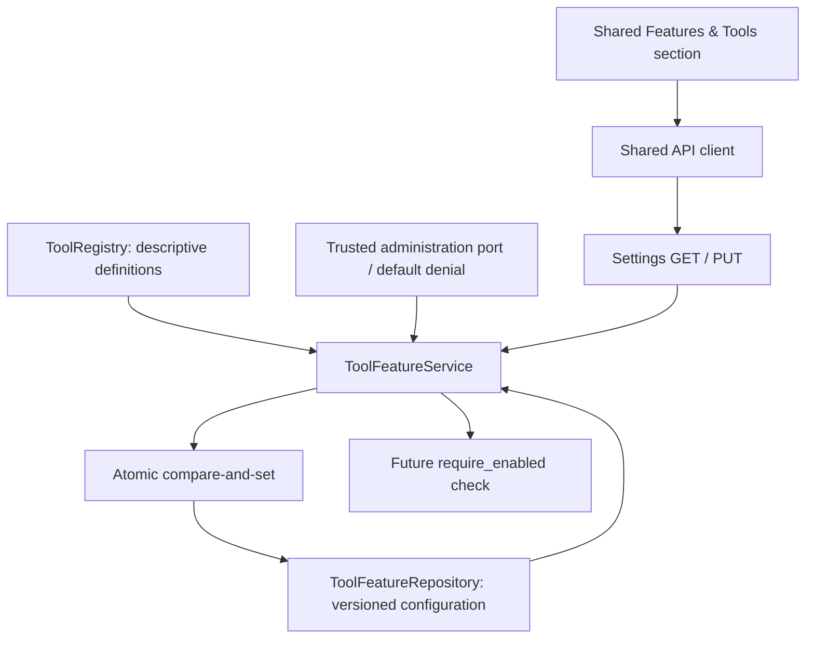

# AVA Phase 6.4 — Frontend Feature Management

Date: 2026-10-12  
Status: implemented and validated within the deployment restriction below.  
Next bounded step: Phase 6.5, after explicit owner authorization.

## Outcome and security limitation

AVA now has backend-authoritative, persistent normalized-tool feature configuration, version-conflict protection, fresh feature evaluation, a Settings API and a shared **Features & Tools** section for Web/Desktop.

**Default deployments are read-only for these administrative settings.** The repository has no trustworthy administrator identity system. Consequently every mutation is denied unless trusted server composition supplies `ToolFeatureAdministrationPort` backed by authenticated current-caller authority or a genuinely restricted deployment boundary. No allowing production adapter, unauthenticated enablement mode, client role header, hardcoded administrator flag or feature environment variable was shipped. This is the fail-closed alternative explicitly required by the Phase 6.4 request, not a claim that enterprise identity is implemented.

The UI displays that restriction and disables edits when the server reports `can_manage: false`. That field is display metadata, not authentication. Forging UI state or an `X-Role: admin` header cannot bypass the service's independent administrative check.

An enabled **feature gate** is not an executable tool, Workspace grant, policy decision or human approval. Current production registry construction remains empty; no fake tool/handler was registered. Legacy OpenHands adapter tools were not integrated with these normalized gates in this step. Future normalized dispatch must call the enforcement boundary and then enforce policy, Workspace authority and required approval separately.

## Architecture and locations



Implemented:

- `backend/src/ava/contracts/tool_features.py`: configuration, update, availability/response DTOs and trusted administration interface.
- `backend/src/ava/repositories/tool_feature_repository.py`: singleton repository and version-conflict contract.
- `backend/src/ava/services/tool_feature_store.py`: locked in-memory implementation.
- `backend/src/ava/infrastructure/persistence/repositories/tool_feature_repository.py`: transactional SQLite implementation.
- `backend/src/ava/infrastructure/persistence/migrations/versions/v0024_tool_features.py`: additive migration, registered in the existing ordered migration registry.
- `backend/src/ava/services/tool_feature_service.py`: default-deny administrative updates and feature evaluation.
- `backend/src/ava/api/routes/tool_features.py`: Settings transport/error mapping.
- Existing application/persistence composition and `api/app.py`: repository/service wiring and optional trusted administration integration.
- `frontend/packages/contracts/src/tools.ts`, `tool-features.ts`: mirrored registry definition metadata and feature wire types.
- `frontend/packages/api-client/src/tool-features.ts`: shared typed GET/PUT wrappers.
- `frontend/packages/settings-core/src/sections/ToolFeaturesSection.tsx`: section, draft editor and configuration confirmations.
- Existing shared Settings destination/nav/workspace and ui-core Settings destination type: one common Web/Desktop entry point.
- Focused backend/frontend/API-client tests and scoped architecture/migration expectation updates.

No new state library or configuration storage system was introduced. Locked master/phase planning documents were not edited. Pre-existing working-tree changes were preserved.

## Contracts and configuration semantics

`ToolFeatureConfiguration` stores:

```json
{
  "framework_enabled": false,
  "enabled_tool_ids": [],
  "configuration_version": 0,
  "contract_version": "v1"
}
```

Version 0 represents missing/unconfigured state and cannot enable anything. Persisted writes advance from expected version N to N+1. Booleans and version integers are strict; IDs use Phase 6.2's stable tool-ID validation. Duplicate/unknown IDs reject before persistence. Transport version v1, configuration revision and SQLite schema version are separate concepts.

`UpdateToolFeaturesRequest` contains required framework boolean, complete enabled-ID collection, and nonnegative `expected_version`, plus v1 transport version. Extra fields such as client administrator claims or permission flags reject. The service revalidates even preconstructed request objects. Enable/disable operations use one complete atomic update rather than separate unsynchronized rows or partial settings mutations.

`ToolFeaturesResponse` returns configuration, `configuration_status` (missing/valid/invalid), server-computed `framework_effective_enabled`, display-only `can_manage`, and ordered per-tool availability records. Each record references the existing `ToolDefinition`, with configured/effective booleans and one reason: configuration_invalid, framework_disabled, tool_disabled, feature_enabled. Registry metadata is not duplicated in persistence or redefined on the backend; TypeScript now mirrors it because this endpoint actually exposes it.

The frontend reads effective states from the response. It manages drafts, not authorization. Requests do not carry execution permissions, Workspace roots, approval decisions, runtime/model selection or user roles.

## Persistence and migration

Current migration registry reaches **schema 24**. Migration 0024 adds only `tool_feature_configuration`, with singleton ID constraint, boolean gate constraint, JSON text for enabled IDs and a positive configuration revision. Verification checks column shape and required constraints. No initial row or enabled-tool backfill is created; absence resolves to disabled state.

The memory and SQLite repositories implement the same compare-and-set behavior. SQLite reads the current version and writes the whole record in the existing `SqliteDatabase.transaction()` boundary. Its transaction/connection lock protects one shared connection, and SQLite transactions arbitrate separately connected writers. A stale expected version raises `ToolFeatureConflictError` without changing state. Concurrent same-version writes have one winner.

Relational persistence survives repository/database reconstruction; registry definitions are reconstructed by trusted composition independently. A newly registered ID is disabled unless explicitly configured. If configuration contains an ID no longer in the current registry, malformed JSON, invalid values, or cannot be read, evaluation returns disabled configuration with invalid status. It does not silently enable known subsets or overwrite the corrupt record. Repair requires trusted maintenance/restoration before normal updates resume.

Current-schema ceilings and migration lists in affected historical persistence/restart tests were extended through 24. Historical seed versions and data-preservation assertions were retained. Existing migration source files 0001–0023 were not changed.

Tests used temporary SQLite fixtures and memory stores. No manual read/write of the developer's active database or configuration was performed.

## Settings API and trusted administration

| Method/path | Behavior |
| --- | --- |
| `GET /settings/tool-features` | Returns master state, current registry metadata, configured/effective gates, reasons and management availability. No registration/execution endpoint. |
| `PUT /settings/tool-features` | Atomically updates framework/individual preferences using expected_version. Service checks trusted administrative authority before validation/writing and again immediately before committing. |

Mutations return normalized errors: 403 feature_administration_required, 409 feature_configuration_conflict, and 422 feature_configuration_invalid. Settings request validation uses AVA's existing safe validation-error handler. Unexpected database/write errors are not presented as successful saves.

`create_app(feature_administration=...)` is trusted composition injection, not a network request field. The supplied capability must obtain real current-request administrative authority or be confined to a deployment that excludes untrusted callers. The port's boolean answer is not itself an identity implementation. A global always-true adapter on a publicly reachable HTTP service would violate this boundary and is not provided. Loopback origin alone, CORS, frontend hiding and role headers are not substitutes for authentication. Tests use a clearly test-only allowing fixture.

Missing authority, provider exceptions and authority withdrawal fail closed. Default denial covers direct service calls as well as HTTP bypass attempts. Later enterprise authorization must supply authenticated administrator identity/provenance and request-scoped access; this step adds no SSO/RBAC, administrator bootstrap or login UI.

## Effective feature evaluation

`ToolFeatureService.state()` always reads the current repository and current registry. No process-local feature cache or browser-stored permission authority exists.

`require_enabled(tool_id)` is the reusable pre-dispatch boundary: reject unknown tools or disabled/invalid gates and otherwise return a detached definition. It conveys **feature eligibility only**. A future dispatcher must combine this with tool policy, caller/use-case allowlist, assigned Workspace/resource authorization, implementation compatibility and approval. It must recheck immediately before effects and coordinate changes/revocation where needed; this method alone is not an atomic authorization lease or exactly-once execution guarantee.

Master off makes every per-tool effective state unavailable while retaining the individual configured preferences. Enabling the framework does not enable new tools automatically. Unknown IDs cannot be enabled through configuration. No ordinary feature configuration requires a new backend environment variable.

## Shared Settings behavior

Features & Tools uses shared semantic shadcn Switch/Button/Dialog controls. It includes master configured/effective state; tool name/description/category/risk; saved/effective individual state; unavailability explanations; empty-registry messaging; and a warning when the framework draft/configuration is enabled with no enabled tools.

Framework enabling requires confirmation. Tool enabling above low risk requires confirmation. Disabling does not prompt. These are configuration confirmations, not the future action-approval framework. Individual switches are disabled while the master draft is off; all controls are disabled during saves or when management is unavailable.

Draft changes do not appear saved until a successful backend response. Saves include the loaded configuration version. Errors retain the draft and authoritative saved state; conflict wording directs the operator to reload. Reload intentionally discards drafts and reads current state. In-flight guards prevent duplicate writes. Generation checks ignore late load/save successes or failures after client changes, reload or unmount. Settings section switching therefore does not publish stale state into another section. Web and Desktop compose this same Settings package.

No live-browser/native-GUI visual acceptance is claimed; interaction behavior is covered by shared component tests and frontend builds.

## Validation

| Gate | Executed result |
| --- | --- |
| Backend feature/architecture/migration/registry/contracts/relational-composition/tool-authorization/command-policy subset | **351 passed in 5.53s**. Feature-only final run: **16 passed in 1.15s**. |
| Historical Folder/Project/CORE and migration-certification persistence subset | **40 passed, 3 skipped in 7.11s**. Skips are existing optional scope-adapter cases. |
| Backend Ruff, `src tests --no-cache` | **PASS**. |
| Strict mypy, backend source plus new feature tests | **PASS**, 262 source/test files. |
| Aggregate `pnpm test` | **1,120 passed, 6 existing live-integration skips** across shared packages/Desktop package. |
| Settings-core final rerun | **219 passed**; includes 6 new feature interaction tests and scoped Settings architecture guard. |
| API-client final rerun | **118 passed**; includes new GET/PUT/version payload and 403 propagation tests. |
| `pnpm lint` | **PASS** across all packages/apps. |
| Web production build | **PASS**. |
| Desktop frontend production build | **PASS**. |
| `git diff --check` | **PASS**. |

Backend subset command (from backend):

```bash
PYTHONDONTWRITEBYTECODE=1 .venv/bin/python -m pytest -q -p no:cacheprovider \
  tests/test_tool_features.py tests/test_architecture.py tests/test_persistence_migrations.py \
  tests/test_tool_registry.py tests/test_tool_contracts.py tests/test_relational_composition.py \
  tests/test_tool_authorization.py tests/test_command_policy.py
```

Coverage includes disabled defaults; master/individual changes; unknown/duplicate IDs; restart; corrupt state; version conflicts and concurrent CAS; new registrations; admin denial/provider failure/withdrawal; API role-header bypass rejection; configuration validation; separate execution authorization; UI loading/retry/confirm/save/conflict/duplicate/stale-response handling; shared Settings routing; and transport contract fields. Guards restrict feature evaluation away from runtime/model/execution infrastructure and routes to contracts/services; schema/persistence wiring guards explicitly include only the implemented new table/port.

Environmental limitations and accuracy of API evidence: the first TestClient-free ASGI HTTP attempt also stalled in this host's AnyIO worker dispatch. The final API test uses HTTPX ASGI routing with a test-local direct worker adapter, exercising actual route/body/response/error handling and unchanged service security checks. It does **not** certify real worker scheduling, a live socket server or production authentication. Production route dispatch was not altered to work around the test environment. A broader subset containing the existing Conversation TestClient integration timed out at 35 seconds; no pass totals are claimed for that attempt. The non-HTTP historical subset above completed separately.

The existing Vite large-chunk advisory remains non-failing. Full `test_all.sh`, native Tauri GUI acceptance, and previously documented wider execution-fixture failures were not re-certified. No test was disabled to hide a new failure; scoped expected API-write/schema sets were updated for the deliberately added capability.

## Deferred work and Phase 6.5 readiness

Feature availability is now a separate reusable backend boundary. Phase 6.5 can extend tool inventory/management after explicit authorization. The default deployment restriction remains: editing requires a trustworthy administrator integration; the read-only production catalog currently has no normalized definitions/handlers.

Deferred: actual tool dispatch/handlers, Native loops, OpenHands integration, Workspace authority, human approvals, operation history, use-case allowlists/entities, RAG, engineering agents and plugin loading. Feature enablement does not bypass any of these mandatory future checks. Existing conversations and non-tool selection behavior were not changed.

Phase 6.4 is complete within the requested fail-closed deployment boundary. Phase 6.5 has not started.
