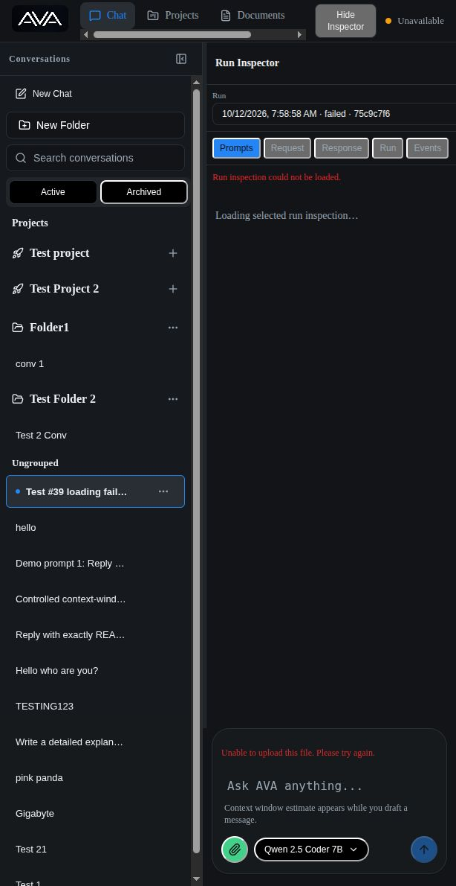
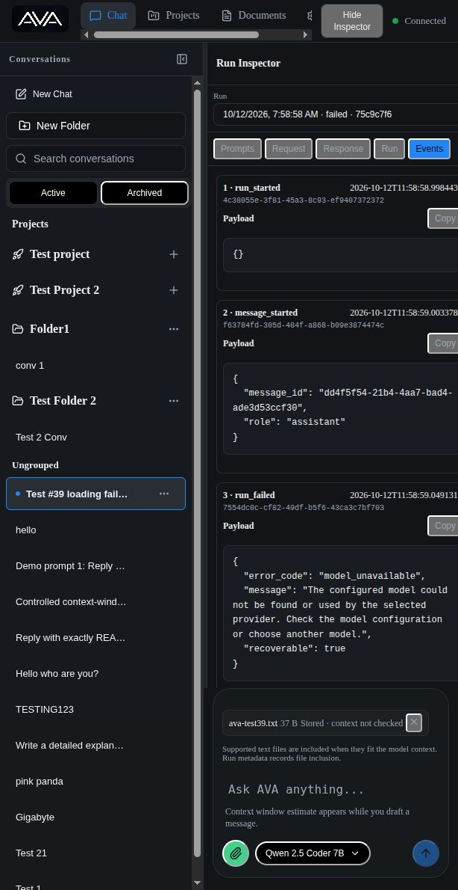
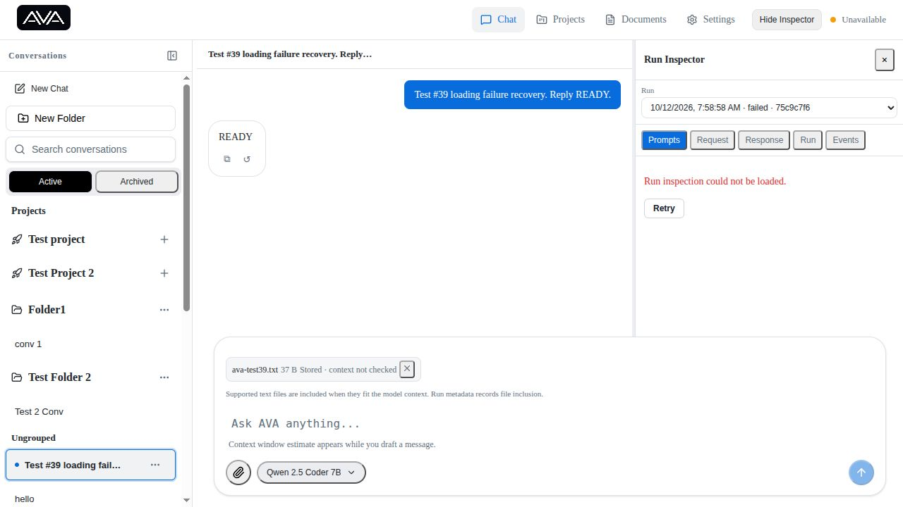
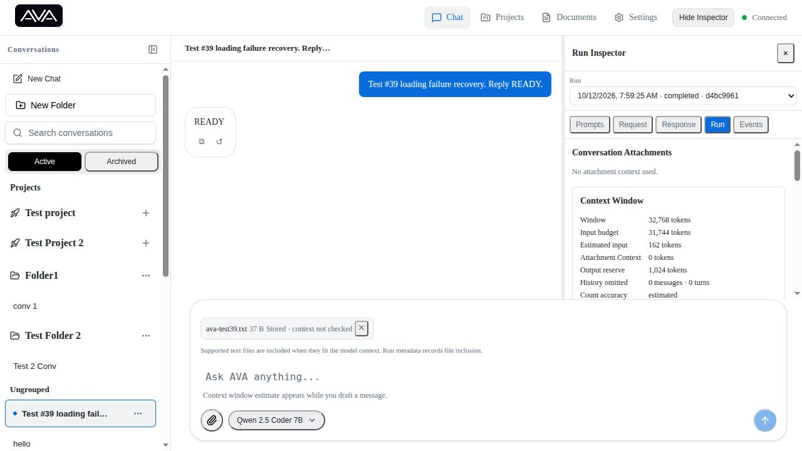

# Test #39 — Loading Failure / Retry Behavior

Date: 2026-10-12. Tested the live Web UI at http://127.0.0.1:5173 with the real local backend and Ollama provider. No application code was changed.

Overall: FAIL — Run Inspector does not end its visible loading state or expose a direct retry after a selected run-detail request fails.

| Case | Result | Evidence |
| --- | --- | --- |
| Conversation load | PASS | Stopped backend and switched to `hello`. `Unable to load this conversation.` and Retry appeared. After backend restart, Retry removed the error and restored the transcript. Cached content belonged to the selected conversation and was accompanied by the load error. |
| Run failure | PASS | In a new test conversation, selected existing invalid model `bb1` (`Badmodelid`). UI surfaced `Model unavailable`, explanatory text, Retry response and Open Model Settings. No ongoing spinner remained. Inspector later confirmed `run_started → message_started → run_failed`, with recoverable `model_unavailable`. Changed the per-run model to Qwen 2.5 Coder 7B and clicked Retry response: Starting appeared, then READY, with normal composer controls restored. |
| Attachment upload | PASS | With backend stopped, uploaded `/tmp/ava-test39.txt`: `Unable to upload this file. Please try again.` appeared, and no stored attachment appeared. Restarted backend and selected the same file again: upload settled with exactly one `ava-test39.txt 37 B`, marked Stored. |
| Run Inspector | FAIL | Loaded completed run d4bc9961, stopped backend, selected failed run 75c9c7f6. Previous inspection content disappeared and `Run inspection could not be loaded.` appeared, but `Loading selected run inspection…` persisted and there was no Retry button. After restart, selecting the other run and then the originally failed selection recovered inspection successfully. |
| Settings/config | PASS | Opened Providers, Models, Runtimes and System Prompts while backend was stopped. Each settled with an explicit error and retry control, with no inventory presented as current. Restarted backend: System Prompts retry loaded definitions; revisiting the other sections reloaded their inventories successfully. |

## Inspector reproduction

1. Open Run Inspector in a conversation with two runs and let one inspection load.
2. Stop backend.
3. Select the other run.
4. Observe the load error alongside persistent loading text and no direct Retry action.
5. Restart backend; switch to the other run and back to recover.

The backend request settles, but the content branch in `frontend/packages/workspace/src/RunInspector.tsx` renders loading whenever a selected run lacks a matching inspection, independent of the settled loading/error state. The identity guard correctly prevents the previous run's data from appearing as the newly selected run.

## Automated verification

The package test wrapper ran the complete workspace, agent-ui, and settings-core suites despite the supplied filename arguments:

- Workspace: 252 passed, 2 failed, 6 skipped.
- Agent UI: 316 passed.
- Settings: 212 passed.
- Total: 780 passed, 2 failed, 6 skipped.

Both workspace failures reproduced in a focused run:

- `resizes the Run Inspector within its minimum and maximum widths`: expected 280, received 380.
- `shows Unavailable for a transport failure from another ApiClient instance and recovers on success`: initial Connected assertion failed, before the intended transport failure/recovery sequence.

The existing four Inspector tests passed but do not cover the observed request-failure/retry defect.

## Final environment

Backend restored at port 8000; existing web server left running. A test conversation with title beginning `Test #39 loading failure recovery. Reply…` remains, containing the failed run, successful retry, and one test attachment. Existing model/provider configuration was not changed. The original VS Code-debugger backend was terminated for the outage; the restored backend runs through `scripts/dev_backend.sh` rather than the debugger.

## Inspector fix and revalidation — 2026-10-12

The original failure above is fixed. Implementation changes are confined to `frontend/packages/workspace/src/RunInspector.tsx` and its focused test file, `RunInspector.test.tsx`. This report and two new screenshots record the revalidation.

Root cause: rendering inferred loading from a selected run having no matching inspection, even after the request's loading flag had settled. The error lived in separate state, so error and loading rendered together.

Inspection now uses one discriminated state: idle, loading, success, or error, keyed by run and conversation. Starting a request invalidates inspection content and replaces any inspection error with loading. Success stores the response; failure settles into an explicit safe error and shared AVA Button labeled Retry. Retry disappears while loading and the synchronous in-flight guard also prevents rapid clicks from creating concurrent inspection requests.

Retry calls the same refresh function as initial inspection and polling. It retains the selected run, cancellation guard, query generation, and response run/conversation identity checks. Effect cleanup invalidates requests on run or conversation changes; stale success and failure cannot overwrite the current selection.

Added six regression cases covering settled failure, Retry visibility, successful retry, repeated failure, rapid submissions, stale retry success/failure, and switching away from an error then returning for a fresh fetch. The first regression was run before implementation and failed specifically because loading text remained after rejection.

Validation:

- Focused command: `pnpm --filter @ava/workspace exec vitest run src/RunInspector.test.tsx src/attachment-inspector.test.tsx src/conversation-selection.test.tsx src/context-attachment-preview.test.tsx` — 57 passed, including all 10 Inspector tests.
- Full workspace suite — 258 passed, 2 failed, 6 skipped. The same two pre-existing AppWorkspace failures recorded above remain; no new test failures.
- Workspace typecheck remains blocked by existing `context_window_tokens` contract errors in ModelConfigurationEditor.tsx and a non-callable value at AppWorkspace.test.tsx:317. No errors remain in either changed Inspector file.
- Live backend outage: switching runs cleared old data and displayed error + Retry, with no loading text. Retry with backend still unavailable returned to error + Retry. After backend restart, direct Retry loaded the same selected run without switching or reloading.
- Live pending retry: paused backend, clicked Retry, observed loading with error and Retry absent, then switched runs before resuming backend. Delayed requests timed out without painting old content; Retry recovered the newly selected run, and its displayed ID matched the selection. Deterministic tests separately verify late successful and failed responses after the new run has loaded.

Backend restored and running on port 8000. No execution, backend contracts, model/provider configuration, or other feature code was changed for this fix.

